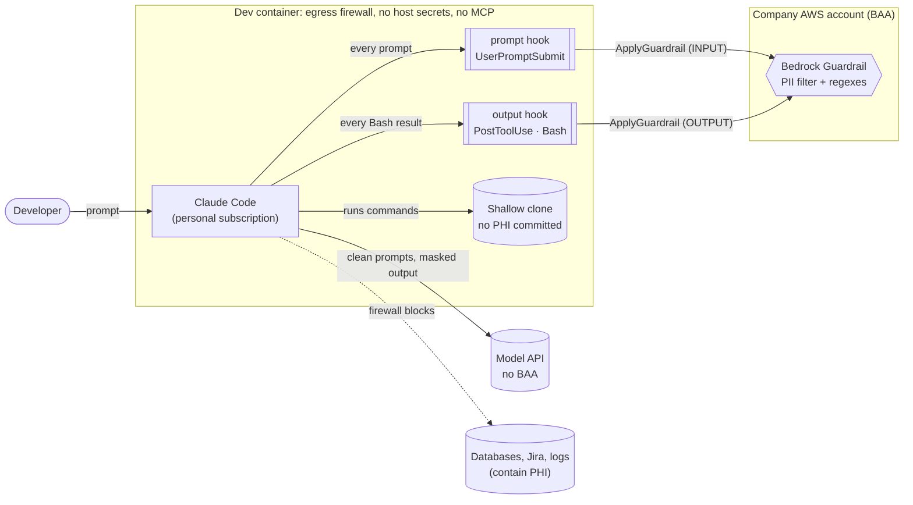
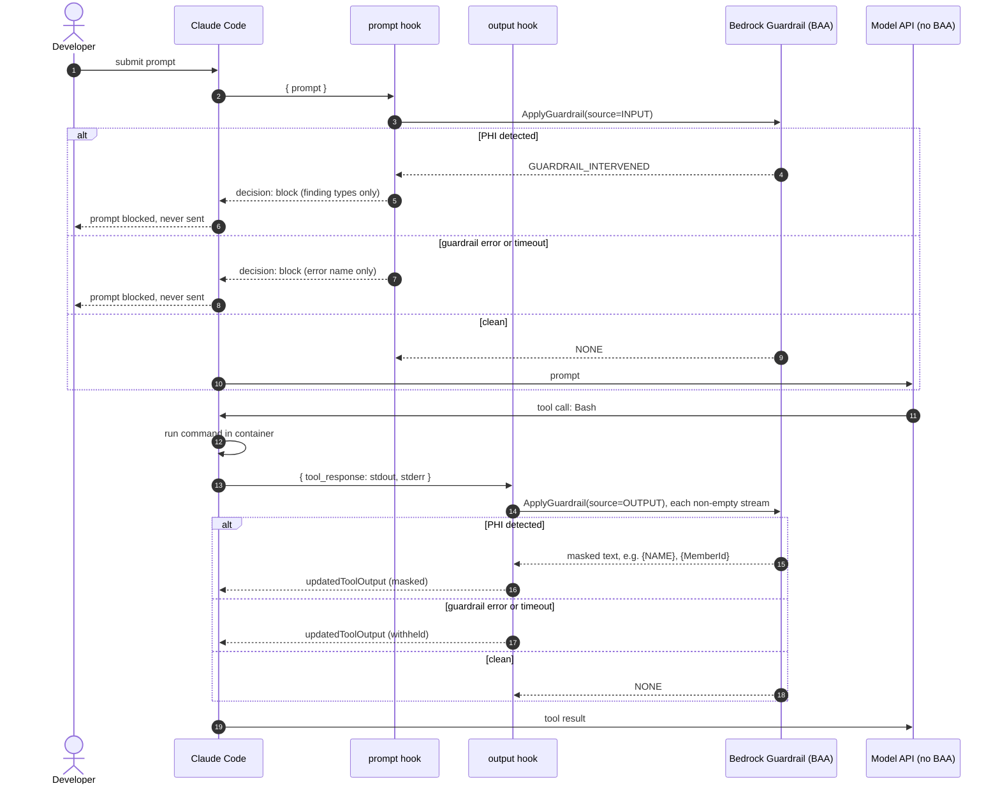

# Build prompt: phi-guard, Part 1 (no AWS access required)

You are building **phi-guard**: a packaged Claude Code plugin plus reference dev container that stops PHI from reaching a model provider that has no BAA. A developer at a health insurer wants to use a **personal** Claude subscription for code-only work. The company's security boundary is:

1. **Sandbox (the actual boundary):** Claude Code runs inside a dev container on a shallow clone of the repo (no PHI is committed). Network egress is allowlisted to the model API plus the AWS endpoints below. There are no MCP connectors and no host credentials.
2. **Hooks (safety net for human error):** a `UserPromptSubmit` hook **blocks** prompts containing PHI, for example a pasted log line. A `PostToolUse` hook on `Bash` **masks** PHI in command output before the model sees it. Both call **Amazon Bedrock Guardrails `ApplyGuardrail`** in the company's AWS account, which is covered by a BAA. Bedrock is approved there.

A working, tested seed implementation is in the **Appendix**. Start from it. Don't redesign it. If this prompt came with the seed files on disk (`src/`, `test/`, `infra/`, `docs/`, ...), use those directly. They're identical to the Appendix. Run `pnpm install && pnpm typecheck && pnpm test` first to confirm the baseline: 14 passing.

**This is Part 1.** You have **no AWS access**. Build, test and verify everything that doesn't need a live guardrail. Part 2 happens later on a work machine with AWS access, and the checklist at the end is for that session. Don't attempt anything in it.

Prerequisites on this machine: Node ≥ 22.6 (tests run `.ts` directly via type stripping; 24.x preferred), pnpm, the `claude` CLI (≥ 2.1.295, needed for `onFailure`), and optionally Docker for the devcontainer build check.

---

## Verified facts (checked on 2026-10-12; don't re-derive, do re-check if something contradicts them)

**Claude Code hooks** ([hooks reference](https://code.claude.com/docs/en/hooks)):
- `UserPromptSubmit` gets `{ prompt, ... }` on stdin. To block, exit 0 and print `{"decision":"block","reason":"..."}`. `reason` is **shown to the user only and not added to context**. Hooks **cannot rewrite** prompts.
- `PostToolUse` gets `{ tool_name, tool_input, tool_response, ... }`. Bash's `tool_response` is `{ stdout, stderr, interrupted, isImage }` and may carry extra fields. To replace the output, print `{"hookSpecificOutput":{"hookEventName":"PostToolUse","updatedToolOutput":{...},"additionalContext":"..."}}`. **If `updatedToolOutput` doesn't match the tool's output schema, it is silently ignored and the ORIGINAL output is used.** The seed spreads the original `tool_response` to keep every field.
- `onFailure: "block"` (≥ 2.1.295) treats can't-start, exit codes other than 0/2, timeout and invalid JSON as failures, and then does whatever exit 2 does for that event. On `UserPromptSubmit` that blocks the prompt. **On `PostToolUse` it does NOT withhold output** ("the tool already ran"). So the output hook must fail closed in its own code. The seed uses a 10s `AbortSignal` under a 20s hook timeout, and a catch block that replaces stdout with a "withheld" message.
- `timeout` is in seconds. Exec form (`"command": "node", "args": [...]`) avoids shell quoting.
- **Tested end to end on Claude Code 2.1.296** with headless `claude -p`:
  - a canary `PostToolUse` hook built on the seed's `maskBashOutput`: the model received `patient {NAME} ok`. So the replacement shape is accepted, and `env` from `--settings` reaches the hook.
  - the seed prompt hook with no guardrail configured: the prompt was blocked.
  - gotcha: `--allowedTools` takes multiple values and swallows a prompt placed after it. Use `--allowedTools=Bash` and redirect `< /dev/null`.

**Claude Code plugins** ([plugin manifest reference](https://code.claude.com/docs/en/plugins-reference)):
- Layout: `.claude-plugin/plugin.json` (only `name` is required; use kebab-case; names starting `claude-`/`anthropic-` are reserved), plus `hooks/hooks.json`. The hooks file **must** wrap the event map in a top-level `"hooks"` key.
- `${CLAUDE_PLUGIN_ROOT}` resolves in hook `command`/`args`. Hook processes get `CLAUDE_PLUGIN_ROOT`, `CLAUDE_PLUGIN_DATA`, `CLAUDE_PROJECT_DIR`, and `CLAUDE_PLUGIN_OPTION_<KEY>` for every `userConfig` option, with KEY uppercased.
- `userConfig` options are strict objects with `type` / `title` / `description` (required) and `required` / `default` / `sensitive` (optional). An unknown key is a load error. Values are stored under `pluginConfigs` in settings. The settings index lists `pluginConfigs` scope as "User or managed".
- Plugins have **no install/build step**. Ship self-contained files, so commit a bundled `dist/`.
- `claude plugin validate <dir>` checks the plugin. `--strict` turns warnings into failures. `--plugin-dir` loads a plugin for a session.

**Managed settings** ([managed settings](https://code.claude.com/docs/en/managed-settings), [devcontainer](https://code.claude.com/docs/en/devcontainer)):
- Linux path: `/etc/claude-code/managed-settings.json`, plus an optional `managed-settings.d/*.json` drop-in directory. These have the highest precedence.
- Anthropic's reference devcontainer is `anthropics/claude-code/.devcontainer/`: `devcontainer.json`, `Dockerfile`, and `init-firewall.sh` (an iptables/ipset allowlist that needs `NET_ADMIN`/`NET_RAW` in `runArgs`).
- The docs warn that a Dockerfile in the repo can be edited by anyone with write access, so for policy engineers can't bypass, use server-managed settings or MDM.

**Bedrock Guardrails** ([ApplyGuardrail API](https://docs.aws.amazon.com/bedrock/latest/APIReference/API_runtime_ApplyGuardrail.html), [CFN PiiEntityConfig](https://docs.aws.amazon.com/AWSCloudFormation/latest/TemplateReference/aws-properties-bedrock-guardrail-piientityconfig.html), [pricing](https://aws.amazon.com/bedrock/pricing/)):
- Request: `{ guardrailIdentifier, guardrailVersion, source: INPUT|OUTPUT, content: [{ text: { text } }] }`. Response: `action: NONE|GUARDRAIL_INTERVENED`, `outputs[].text`, and `assessments[].sensitiveInformationPolicy.{piiEntities[].{type,match,action}, regexes[].{name,match,action}}`. **`match` contains the raw PHI, so never log it or echo it.**
- PII entities and regexes each support separate `InputAction`/`OutputAction` (BLOCK|ANONYMIZE|NONE).
- There is **no DATE/DOB PII type**. The template covers DOB with a key=value regex.
- Pricing: the PII filter is $0.10 per 1,000 text units, where a unit is up to 1,000 characters, rounded up per request. Regex and word filters are free. Default throughput is about 200 text units/second and 50 calls/second per account and region (AWS announcement, Feb 2025; Part 2 checks Service Quotas).
- Comprehend Medical DetectPHI costs $0.0014 per 100-character unit with a 1-unit minimum (AWS price list, us-east-1), about 140× Guardrails. It was rejected for output scanning and is an optional prompt-only add-on (~$15/dev/month). **Don't build it.**

## Unverified (needs live AWS, so it's Part 2. Never claim these work; write the code so they're easy to check)
1. The regex dialect Guardrails accepts. The `DateOfBirth` pattern avoids inline flags and uses only portable syntax.
2. Whether `InputAction`/`OutputAction` take precedence over the legacy required `Action` (set to BLOCK). Prompts are safe either way, because the hook blocks on **any** intervention.
3. That the IAM resource for `bedrock:ApplyGuardrail` is the guardrail ARN from `GetAtt GuardrailArn`.
4. The masked tag format: `{NAME}` for PII, and `{MemberId}` for regexes is assumed.
5. Real latency per call, and throttling behavior.
6. That managed `pluginConfigs` + `enabledPlugins` can force-configure and force-enable the plugin, and how `allowManagedHooksOnly` treats a plugin force-enabled by managed settings. **You can verify this one without AWS**, using a throwaway managed-settings file in the devcontainer or a headless run. Do it and record the result.

---

## What to build

### 1. Restructure the seed into a bundled plugin
- Keep `src/guardrail.ts` (`createScanner`, the `Scan` type, `errorName`) and the pure handlers `checkPrompt` and `maskBashOutput`.
- Move the stdin/stdout wiring out of `import.meta.main` blocks into thin entrypoints, `src/bin/prompt.ts` and `src/bin/bash-output.ts`. That drops the Node ≥ 24.2 requirement and makes bundling simpler.
- **Config comes from plugin options only.** Replace `scannerFromEnv` with a function that reads:
  - `CLAUDE_PLUGIN_OPTION_GUARDRAIL_ID` (required)
  - `CLAUDE_PLUGIN_OPTION_GUARDRAIL_VERSION` (required)
  - `CLAUDE_PLUGIN_OPTION_AWS_REGION` (required)
  - `CLAUDE_PLUGIN_OPTION_AWS_PROFILE` (optional)

  Pass `region` and, when set, `profile` to `new BedrockRuntimeClient({ ... })`. Keep the named `MissingGuardrailConfig` error.
- Bundle each entrypoint with **esbuild** into `dist/prompt.mjs` and `dist/bash-output.mjs`: `--bundle --platform=node --format=esm`, targeting Node 20. The AWS SDK is inlined, so there's no runtime `node_modules`. If the SDK triggers "Dynamic require … not supported", add the standard `createRequire` banner. **Commit `dist/`.**
- `.claude-plugin/plugin.json`:
  - name `phi-guard`, plus version, description, author
  - `userConfig` for `guardrail_id`, `guardrail_version`, `aws_region` (all `required: true`) and `aws_profile` (optional)
- `hooks/hooks.json`, in exec form:
  - `node ${CLAUDE_PLUGIN_ROOT}/dist/prompt.mjs` on `UserPromptSubmit`
  - `node ${CLAUDE_PLUGIN_ROOT}/dist/bash-output.mjs` on `PostToolUse` with matcher `Bash`
  - both with `"timeout": 20` and `"onFailure": "block"`, plus `statusMessage`
- `.claude-plugin/marketplace.json`, making the repo a single-plugin marketplace so it installs with `/plugin marketplace add <path-or-git-url>`. Get the exact schema from the [marketplace reference](https://code.claude.com/docs/en/plugins/marketplace-reference).
- Move `infra/guardrail.yaml` over unchanged, except as noted in section 3.

### 2. Tests (`node:test`, no extra framework)
- Keep all seed unit tests, updated for the restructure.
- Point the **fail-closed tests at `dist/*.mjs`**, the shipped artifact, not the sources:
  - no config → the prompt hook blocks and the bash hook replaces output with "withheld"
  - unreadable stdin → the same outcomes
  - the withheld output keeps the extra `tool_response` fields
- Add `scripts/e2e.sh`, a headless Claude Code check of the hook contract against the **installed** CLI. It costs a few tokens, so run it manually and keep it out of `pnpm test`. It should:
  1. Load the plugin via `--plugin-dir`.
  2. Set `pluginConfigs` in a temp `--settings` file with a deliberately bogus guardrail ID.
  3. Run `claude -p ... --allowedTools=Bash < /dev/null` with a prompt that echoes a canary.
  4. Assert: the prompt is blocked. Without AWS credentials the scan errors, so fail-closed **blocks** it, and that is the expected Part 1 result.
  5. Run a second scenario that confirms the bash hook path, with a test-only plugin config or the canary approach in the Appendix, and assert the model only sees masked/withheld output.

  Document both expected outcomes in the script header.
- `pnpm check` runs: typecheck, tests, build, a check that `dist/` matches a fresh build (fail if stale), `claude plugin validate . --strict`, and `cfn-lint infra/guardrail.yaml`. Use `uvx cfn-lint`, or skip it with a printed warning if `uv` is absent.

### 3. Reference devcontainer (`.devcontainer/`)
- Fetch Anthropic's reference (`anthropics/claude-code/.devcontainer/`) and **adapt** it rather than writing a firewall from scratch. Keep its license/attribution.
- Firewall allowlist:
  - Anthropic API and auth domains: take them from the reference and from [network config](https://code.claude.com/docs/en/network-config)
  - `bedrock-runtime.${AWS_REGION}.amazonaws.com`
  - `sts.${AWS_REGION}.amazonaws.com`
  - nothing else beyond what the reference needs for install
  - **Note in the docs that AWS endpoint IPs rotate.** The reference resolves DNS once at startup, so document how to re-run the init script, and record the risk.
- Install the plugin at build time from the repo copy (e.g. `/opt/phi-guard`). In `/etc/claude-code/managed-settings.d/phi-guard.json`:
  - force-enable it (`enabledPlugins`) and register the local marketplace (`extraKnownMarketplaces`)
  - set `pluginConfigs` with **placeholder values that are filled in at Part 2**
  - set `permissions.disableBypassPermissionsMode: "disable"`
  - add whatever key empties the MCP server allowlist (check the [settings reference](https://code.claude.com/docs/en/settings))
- Verify unverified item 6 here and record the outcome.
- Put a scoped `phi-guard` AWS profile in the image's AWS config as a **placeholder**. The credential strategy is decided in Part 2. The IAM policy in `infra/guardrail.yaml` allows only `bedrock:ApplyGuardrail` on this guardrail, because the agent can read whatever credentials are in the container.
- If Docker is available, `docker build` the image. Don't run the firewall on this machine.

### 4. Docs (the user explicitly asked for these)
- `README.md`: what it is, install (plugin via marketplace, or the devcontainer), config options, `pnpm check`, and costs. Keep it short.
- `docs/ARCHITECTURE.md`: use the content in the next section as the base, and update anything the restructure changes. Mermaid must render on GitHub.

### Constraints
- TypeScript, ESM, pnpm. Use `node:` built-ins over deps: `node:test`, and `node:stream/consumers` `json()` for stdin. The only runtime dep is `@aws-sdk/client-bedrock-runtime`. Dev deps: `typescript`, `@types/node`, `esbuild`.
- No inline imports. Match the seed's style and comment density. Don't add features beyond this list.
- **Never** log, print or echo matched values. Hooks report only finding *types* and error *names*.
- Every failure path either blocks the prompt or withholds the output. A new code path that can fail open is a bug.
- Commit in logical steps on a branch, with no PHI and no real ID patterns anywhere. Test fixtures use obviously fake data.

### Stretch, only after 1–4 pass `pnpm check`
- **Read-tool coverage.** Files the agent opens with `Read`, and `@file` mentions, bypass both hooks. First, find the real `Read` `tool_response` shape empirically, with a canary `PostToolUse` hook that logs stdin to a temp file. Then either mask via `updatedToolOutput` (only if a canary test proves the shape is accepted) or deny via `PreToolUse` after scanning the file. Add an e2e scenario for it.

### Out of scope
Codex CLI support, Comprehend Medical, deploying anything to AWS, a "log-only" mode, CI pipelines.

### Definition of done for Part 1
`pnpm check` passes, `scripts/e2e.sh` passes with the expected fail-closed outcomes, and the devcontainer builds (if Docker is available). Finish with a short report that covers:
- what was built
- the result of unverified item 6
- anything in "Verified facts" that turned out wrong
- the exact list of remaining Part 2 items

---

## docs/ARCHITECTURE.md (base content)

````markdown
# phi-guard architecture

phi-guard lets a developer use a coding agent whose provider has no BAA, on
code-only work, without PHI reaching that provider. The sandbox does most of the
work. The hooks catch the human mistakes the sandbox can't, such as pasting a log line.

## Components and trust boundaries



## Request flow



## What covers which path

| Way PHI could reach the model | Control | Status |
|---|---|---|
| Live systems (DBs, Jira, log tools) | Container egress firewall | Covered |
| Host secrets and config (`~/.aws`, `~/.ssh`, MCP config) | Container boundary | Covered |
| Committed fixtures and history | Policy: no PHI committed; shallow clone | Covered by policy |
| Text the developer types or pastes | Prompt hook (block) | Covered, limited by detection |
| Command output (tests, scripts) | Output hook (mask) | Covered, limited by detection |
| Files read with the Read tool, `@file` mentions | Not yet | **Gap** (stretch goal) |
| Pasted screenshots | None (no hook sees images) | **Gap**: policy only |

## Failure behavior

| Failure | Prompt hook | Output hook |
|---|---|---|
| Guardrail flags PHI | Blocks the prompt | Masks the values |
| AWS error, throttling, bad credentials | Blocks (own catch) | Withholds output (own catch) |
| Scan slower than 10s | Blocks (AbortSignal) | Withholds (AbortSignal) |
| Hook crashes or exceeds 20s | Blocks (`onFailure: "block"`) | **Fails open**: `onFailure` can't withhold PostToolUse output |
| Replacement output has the wrong shape | n/a | **Fails open**: Claude Code ignores it. The hook spreads the original fields, and `scripts/e2e.sh` checks this |

The two fail-open rows are why the output hook is bundled with no runtime
dependencies, and why its own timeout sits well under the hook timeout.

## Detection limits

- The PII filter catches names, addresses, emails, phones, SSNs and similar
  identifiers. It does not catch diagnoses or clinical free text.
- Member IDs and claim numbers are caught by **your** regexes, configured as
  CloudFormation parameters at deploy time.
- There is no date-of-birth type. A regex catches DOB-named keys with a date value.
- URL, IP_ADDRESS, AGE, USERNAME and PASSWORD are off because they're noisy in dev
  output.

## Cost (Guardrails PII filter at $0.10 per 1,000 text units; regexes free)

| Usage | Per developer per month |
|---|---|
| Prompts only | ~$0.20 |
| Prompts + Bash output | ~$5 |
| Heavy agentic use | ~$40 |
````

---

## Part 2 checklist (work machine with AWS access; for reference only, don't do this in Part 1)
1. Fill in `MemberIdPattern` and `ClaimNumberPattern`. Test them against **synthetic** examples only.
2. Deploy `infra/guardrail.yaml` to the BAA-covered account:
   `aws cloudformation deploy ... --capabilities CAPABILITY_IAM`
3. Smoke-test `ApplyGuardrail` directly. Resolve unverified items 1–5:
   - regex dialect
   - action precedence
   - IAM resource
   - tag format
   - latency, plus Service Quotas for text units/second
4. Pick the credential strategy for the container (short-lived and scoped to the managed policy), and fill in the managed-settings placeholders.
5. Run `scripts/e2e.sh` against the real guardrail. Expect: a fake SSN prompt is blocked, a fake member ID in `echo` output is masked, and a clean prompt passes.
6. Watch false positives for a week and tune the entity list. Get security sign-off.

---

## Appendix: verified seed implementation

These files are the tested starting point: 14 tests pass, `tsc` is clean, and `cfn-lint` is clean. Recreate them exactly, then restructure per section 1.


### `package.json`

````json
{
  "name": "phi-guard",
  "private": true,
  "type": "module",
  "engines": {
    "node": ">=24.2"
  },
  "scripts": {
    "typecheck": "tsc",
    "test": "node --test 'test/**/*.test.ts'"
  },
  "dependencies": {
    "@aws-sdk/client-bedrock-runtime": "^3.1149.0"
  },
  "devDependencies": {
    "@types/node": "^24.19.2",
    "typescript": "^7.0.2"
  }
}
````

### `tsconfig.json`

````json
{
  "compilerOptions": {
    "target": "es2024",
    "module": "nodenext",
    "moduleResolution": "nodenext",
    "types": ["node"],
    "strict": true,
    "noEmit": true,
    "allowImportingTsExtensions": true,
    "erasableSyntaxOnly": true,
    "verbatimModuleSyntax": true,
    "skipLibCheck": true
  },
  "include": ["src", "test"]
}
````

### `.gitignore`

````text
node_modules/
````

### `src/guardrail.ts`

````ts
import {
  ApplyGuardrailCommand,
  BedrockRuntimeClient,
  type ApplyGuardrailCommandInput,
  type ApplyGuardrailCommandOutput,
  type GuardrailContentSource,
} from '@aws-sdk/client-bedrock-runtime';

export type ApplyGuardrail = (
  input: ApplyGuardrailCommandInput,
  abortSignal: AbortSignal,
) => Promise<ApplyGuardrailCommandOutput>;

export interface ScanResult {
  intervened: boolean;
  /** The guardrail's masked text when it intervened, otherwise the original text. */
  text: string;
  /** Detected PII entity types and regex names. Never the matched values. */
  findings: string[];
}

export type Scan = (text: string, source: GuardrailContentSource) => Promise<ScanResult>;

// Well under the hook timeouts in settings.example.json, so a slow call lands in
// the hook's own fail-closed path instead of being killed by Claude Code.
const SCAN_TIMEOUT_MS = 10_000;

export function createScanner(
  apply: ApplyGuardrail,
  guardrailIdentifier: string,
  guardrailVersion: string,
): Scan {
  return async (text, source) => {
    const response = await apply(
      { guardrailIdentifier, guardrailVersion, source, content: [{ text: { text } }] },
      AbortSignal.timeout(SCAN_TIMEOUT_MS),
    );
    if (response.action !== 'GUARDRAIL_INTERVENED') {
      return { intervened: false, text, findings: [] };
    }

    const policies = (response.assessments ?? []).flatMap((a) => a.sensitiveInformationPolicy ?? []);
    const findings = new Set([
      ...policies.flatMap((p) => p.piiEntities ?? []).filter((e) => e.action !== 'NONE').map((e) => e.type),
      ...policies.flatMap((p) => p.regexes ?? []).filter((r) => r.action !== 'NONE').map((r) => r.name),
    ]);
    return {
      intervened: true,
      text: (response.outputs ?? []).map((o) => o.text ?? '').join(''),
      findings: [...findings].filter((f) => f !== undefined),
    };
  };
}

export function scannerFromEnv(): Scan {
  const { PHI_GUARD_GUARDRAIL_ID: id, PHI_GUARD_GUARDRAIL_VERSION: version } = process.env;
  if (!id || !version) {
    throw Object.assign(new Error('PHI_GUARD_GUARDRAIL_ID and PHI_GUARD_GUARDRAIL_VERSION must be set'), {
      name: 'MissingGuardrailConfig',
    });
  }
  const client = new BedrockRuntimeClient({});
  return createScanner(
    (input, abortSignal) => client.send(new ApplyGuardrailCommand(input), { abortSignal }),
    id,
    version,
  );
}

/** Error name only: messages can quote the input, and hook output may reach the model. */
export function errorName(error: unknown): string {
  return error instanceof Error ? error.name : 'UnknownError';
}
````

### `src/hooks/prompt.ts`

````ts
// UserPromptSubmit hook: blocks a prompt the guardrail flags. Hooks can't rewrite
// prompts, so blocking is the only option. The reason is shown to the user only.
import { json } from 'node:stream/consumers';
import { errorName, scannerFromEnv, type Scan } from '../guardrail.ts';

interface BlockDecision {
  decision: 'block';
  reason: string;
}

export async function checkPrompt(prompt: string, scan: Scan): Promise<BlockDecision | undefined> {
  const result = await scan(prompt, 'INPUT');
  if (!result.intervened) return undefined;
  const found = result.findings.join(', ') || 'sensitive data';
  return {
    decision: 'block',
    reason: `phi-guard blocked this prompt: possible ${found}. Remove it and resubmit.`,
  };
}

if (import.meta.main) {
  let decision: BlockDecision | undefined;
  try {
    const { prompt } = (await json(process.stdin)) as { prompt: string };
    decision = await checkPrompt(prompt, scannerFromEnv());
  } catch (error) {
    decision = {
      decision: 'block',
      reason: `phi-guard could not scan this prompt (${errorName(error)}), so it was blocked.`,
    };
  }
  if (decision) process.stdout.write(JSON.stringify(decision));
}
````

### `src/hooks/bash-output.ts`

````ts
// PostToolUse hook (matcher: Bash): masks what the guardrail flags in command output
// before the model sees it. onFailure "block" can't withhold output on PostToolUse
// (the tool already ran), so every failure path here must replace the output itself.
import { json } from 'node:stream/consumers';
import { errorName, scannerFromEnv, type Scan } from '../guardrail.ts';

interface BashResponse {
  stdout: string;
  stderr: string;
  interrupted: boolean;
  isImage: boolean;
}

interface PostToolUseOutput {
  hookSpecificOutput: {
    hookEventName: 'PostToolUse';
    updatedToolOutput: BashResponse;
    additionalContext?: string;
  };
}

function replaceOutput(updatedToolOutput: BashResponse, additionalContext?: string): PostToolUseOutput {
  return { hookSpecificOutput: { hookEventName: 'PostToolUse', updatedToolOutput, additionalContext } };
}

function withheld(response: BashResponse, why: string): PostToolUseOutput {
  // Spread keeps any extra fields Bash returns: a shape mismatch makes Claude Code
  // silently fall back to the original, unmasked output.
  return replaceOutput({ ...response, stdout: `[phi-guard: output withheld, ${why}]`, stderr: '', isImage: false });
}

export async function maskBashOutput(response: BashResponse, scan: Scan): Promise<PostToolUseOutput | undefined> {
  if (response.isImage) return withheld(response, 'image output cannot be scanned');

  const [stdout, stderr] = await Promise.all(
    [response.stdout, response.stderr].map((text) => (text ? scan(text, 'OUTPUT') : undefined)),
  );
  if (!stdout?.intervened && !stderr?.intervened) return undefined;

  const findings = new Set([...(stdout?.findings ?? []), ...(stderr?.findings ?? [])]);
  return replaceOutput(
    { ...response, stdout: stdout?.text ?? response.stdout, stderr: stderr?.text ?? response.stderr },
    `phi-guard masked ${[...findings].join(', ') || 'sensitive data'} in this output.`,
  );
}

if (import.meta.main) {
  // Minimal documented Bash shape, used if stdin itself can't be read.
  let response: BashResponse = { stdout: '', stderr: '', interrupted: false, isImage: false };
  let output: PostToolUseOutput | undefined;
  try {
    ({ tool_response: response } = (await json(process.stdin)) as { tool_response: BashResponse });
    output = await maskBashOutput(response, scannerFromEnv());
  } catch (error) {
    output = withheld(response, `scan failed (${errorName(error)})`);
  }
  if (output) process.stdout.write(JSON.stringify(output));
}
````

### `test/guardrail.test.ts`

````ts
import assert from 'node:assert/strict';
import { test } from 'node:test';
import type { ApplyGuardrailCommandInput, ApplyGuardrailCommandOutput } from '@aws-sdk/client-bedrock-runtime';
import { createScanner } from '../src/guardrail.ts';

function scannerReturning(response: Partial<ApplyGuardrailCommandOutput>) {
  const calls: ApplyGuardrailCommandInput[] = [];
  const scan = createScanner(
    async (input) => {
      calls.push(input);
      return response as ApplyGuardrailCommandOutput;
    },
    'gr-123',
    '2',
  );
  return { scan, calls };
}

test('sends the text to the configured guardrail version with the given source', async () => {
  const { scan, calls } = scannerReturning({ action: 'NONE' });
  await scan('hello', 'OUTPUT');
  assert.deepEqual(calls, [
    { guardrailIdentifier: 'gr-123', guardrailVersion: '2', source: 'OUTPUT', content: [{ text: { text: 'hello' } }] },
  ]);
});

test('returns the original text when the guardrail does not intervene', async () => {
  const { scan } = scannerReturning({ action: 'NONE', outputs: [] });
  assert.deepEqual(await scan('nothing here', 'INPUT'), { intervened: false, text: 'nothing here', findings: [] });
});

test('returns masked text and acted-on finding names, never matched values', async () => {
  const { scan } = scannerReturning({
    action: 'GUARDRAIL_INTERVENED',
    outputs: [{ text: 'member {NAME} id {MemberId}' }],
    assessments: [
      {
        sensitiveInformationPolicy: {
          piiEntities: [
            { type: 'NAME', match: 'Jane Roe', action: 'ANONYMIZED', detected: true },
            { type: 'AGE', match: '40 years', action: 'NONE', detected: true },
          ],
          regexes: [{ name: 'MemberId', match: 'M123456789', action: 'ANONYMIZED', detected: true }],
        },
      },
    ],
  });
  const result = await scan('member Jane Roe id M123456789, 40 years', 'OUTPUT');
  assert.deepEqual(result, { intervened: true, text: 'member {NAME} id {MemberId}', findings: ['NAME', 'MemberId'] });
  assert.doesNotMatch(JSON.stringify(result), /Jane Roe|M123456789/);
});

test('propagates guardrail errors so hooks can fail closed', async () => {
  const scan = createScanner(
    async () => {
      throw Object.assign(new Error('rate exceeded'), { name: 'ThrottlingException' });
    },
    'gr-123',
    '2',
  );
  await assert.rejects(scan('text', 'INPUT'), { name: 'ThrottlingException' });
});
````

### `test/hooks.test.ts`

````ts
import assert from 'node:assert/strict';
import { test } from 'node:test';
import type { Scan } from '../src/guardrail.ts';
import { maskBashOutput } from '../src/hooks/bash-output.ts';
import { checkPrompt } from '../src/hooks/prompt.ts';

const clean: Scan = async (text) => ({ intervened: false, text, findings: [] });

/** Masks every occurrence of `secret` as {NAME}. */
const masking =
  (secret: string): Scan =>
  async (text) =>
    text.includes(secret)
      ? { intervened: true, text: text.replaceAll(secret, '{NAME}'), findings: ['NAME'] }
      : { intervened: false, text, findings: [] };

const bash = { stdout: '', stderr: '', interrupted: false, isImage: false };

test('prompt: allows a clean prompt', async () => {
  assert.equal(await checkPrompt('refactor the claims parser', clean), undefined);
});

test('prompt: blocks a flagged prompt, naming types but not values', async () => {
  const decision = await checkPrompt('why did Jane Roe get a 500?', masking('Jane Roe'));
  assert.equal(decision?.decision, 'block');
  assert.match(decision!.reason, /NAME/);
  assert.doesNotMatch(decision!.reason, /Jane Roe/);
});

test('bash: leaves clean output untouched', async () => {
  assert.equal(await maskBashOutput({ ...bash, stdout: 'ok 12 tests passed' }, clean), undefined);
});

test('bash: masks stdout and stderr independently and keeps extra fields', async () => {
  const response = { ...bash, stdout: 'Jane Roe\nok', stderr: 'warn: Jane Roe', returnCodeInterpretation: 'x' };
  const output = await maskBashOutput(response, masking('Jane Roe'));
  assert.deepEqual(output?.hookSpecificOutput.updatedToolOutput, {
    ...response,
    stdout: '{NAME}\nok',
    stderr: 'warn: {NAME}',
  });
  assert.match(output!.hookSpecificOutput.additionalContext!, /NAME/);
});

test('bash: skips scanning empty streams', async () => {
  const scanned: string[] = [];
  await maskBashOutput({ ...bash, stdout: 'out' }, async (text) => {
    scanned.push(text);
    return { intervened: false, text, findings: [] };
  });
  assert.deepEqual(scanned, ['out']);
});

test('bash: withholds image output it cannot scan', async () => {
  const output = await maskBashOutput({ ...bash, stdout: 'iVBORw0KGgo...', isImage: true }, clean);
  assert.match(output!.hookSpecificOutput.updatedToolOutput.stdout, /withheld/);
  assert.equal(output!.hookSpecificOutput.updatedToolOutput.isImage, false);
});
````

### `test/fail-closed.test.ts`

````ts
// Runs the hook entrypoints as Claude Code would, with no guardrail configured,
// to prove every failure path blocks or withholds rather than passing through.
import assert from 'node:assert/strict';
import { spawnSync } from 'node:child_process';
import { test } from 'node:test';

function runHook(script: string, stdin: string) {
  const { PHI_GUARD_GUARDRAIL_ID, PHI_GUARD_GUARDRAIL_VERSION, ...env } = process.env;
  const result = spawnSync('node', [new URL(`../src/hooks/${script}`, import.meta.url).pathname], {
    input: stdin,
    env,
    encoding: 'utf8',
  });
  assert.equal(result.status, 0, result.stderr);
  return JSON.parse(result.stdout);
}

test('prompt hook blocks when the guardrail is not configured', () => {
  const output = runHook('prompt.ts', JSON.stringify({ prompt: 'hello' }));
  assert.equal(output.decision, 'block');
  assert.match(output.reason, /could not scan this prompt \(MissingGuardrailConfig\)/);
});

test('prompt hook blocks on unreadable input', () => {
  assert.equal(runHook('prompt.ts', 'not json').decision, 'block');
});

test('bash hook withholds output when the guardrail is not configured', () => {
  const tool_response = { stdout: 'Jane Roe', stderr: 'x', interrupted: false, isImage: false, extra: 1 };
  const output = runHook('bash-output.ts', JSON.stringify({ tool_name: 'Bash', tool_response }));
  assert.deepEqual(output.hookSpecificOutput.updatedToolOutput, {
    ...tool_response,
    stdout: '[phi-guard: output withheld, scan failed (MissingGuardrailConfig)]',
    stderr: '',
  });
});

test('bash hook withholds output on unreadable input', () => {
  const output = runHook('bash-output.ts', 'not json');
  assert.match(output.hookSpecificOutput.updatedToolOutput.stdout, /withheld/);
});
````

### `infra/guardrail.yaml`

````yaml
AWSTemplateFormatVersion: '2010-09-09'
Description: >-
  phi-guard: Bedrock guardrail used by Claude Code hooks to block PHI in prompts
  and mask it in command output before it reaches a model without a BAA.

# Deploy into the BAA-covered account. Every scan sends the suspect text to Bedrock.
#
# Billing is per policy, not per entity: the PII filter costs $0.10 per 1,000 text
# units however many entity types are on, and regexes are free.
#
# Each entity sets InputAction (prompts, which the hook blocks) and OutputAction
# (command output, which the hook masks). The prompt hook blocks on any
# intervention, so the legacy Action field is set to BLOCK as the safest fallback.

Parameters:
  MemberIdPattern:
    Type: String
    Description: Regex for your member ID format. No default, so a placeholder can't ship.
  ClaimNumberPattern:
    Type: String
    Description: Regex for your claim number format. No default, so a placeholder can't ship.
  VersionDescription:
    Type: String
    Default: v1
    Description: >-
      A GuardrailVersion is a frozen snapshot. Change this value to publish a new
      version after editing the guardrail, then update PHI_GUARD_GUARDRAIL_VERSION.

Resources:
  Guardrail:
    Type: AWS::Bedrock::Guardrail
    Properties:
      Name: phi-guard
      Description: Blocks PHI in coding-agent prompts; masks it in command output.
      BlockedInputMessaging: 'phi-guard: prompt blocked, sensitive data detected.'
      BlockedOutputsMessaging: '[phi-guard: output withheld, sensitive data detected]'
      SensitiveInformationPolicyConfig:
        # Left out on purpose: URL, IP_ADDRESS, AGE, USERNAME, PASSWORD. They are
        # constant in ordinary dev output, and the false positives would make the
        # hooks unusable. HIPAA counts URLs/IPs as identifiers, so revisit if needed.
        PiiEntitiesConfig:
          - { Type: NAME, Action: BLOCK, InputAction: BLOCK, OutputAction: ANONYMIZE }
          - { Type: ADDRESS, Action: BLOCK, InputAction: BLOCK, OutputAction: ANONYMIZE }
          - { Type: EMAIL, Action: BLOCK, InputAction: BLOCK, OutputAction: ANONYMIZE }
          - { Type: PHONE, Action: BLOCK, InputAction: BLOCK, OutputAction: ANONYMIZE }
          - { Type: US_SOCIAL_SECURITY_NUMBER, Action: BLOCK, InputAction: BLOCK, OutputAction: ANONYMIZE }
          - { Type: US_INDIVIDUAL_TAX_IDENTIFICATION_NUMBER, Action: BLOCK, InputAction: BLOCK, OutputAction: ANONYMIZE }
          - { Type: US_PASSPORT_NUMBER, Action: BLOCK, InputAction: BLOCK, OutputAction: ANONYMIZE }
          - { Type: DRIVER_ID, Action: BLOCK, InputAction: BLOCK, OutputAction: ANONYMIZE }
          - { Type: LICENSE_PLATE, Action: BLOCK, InputAction: BLOCK, OutputAction: ANONYMIZE }
          - { Type: VEHICLE_IDENTIFICATION_NUMBER, Action: BLOCK, InputAction: BLOCK, OutputAction: ANONYMIZE }
          - { Type: US_BANK_ACCOUNT_NUMBER, Action: BLOCK, InputAction: BLOCK, OutputAction: ANONYMIZE }
          - { Type: CREDIT_DEBIT_CARD_NUMBER, Action: BLOCK, InputAction: BLOCK, OutputAction: ANONYMIZE }
          # Not PHI, but the sandbox holds AWS credentials for this guardrail.
          - { Type: AWS_ACCESS_KEY, Action: BLOCK, InputAction: BLOCK, OutputAction: ANONYMIZE }
          - { Type: AWS_SECRET_KEY, Action: BLOCK, InputAction: BLOCK, OutputAction: ANONYMIZE }
        RegexesConfig:
          - Name: MemberId
            Pattern: !Ref MemberIdPattern
            Action: BLOCK
            InputAction: BLOCK
            OutputAction: ANONYMIZE
          - Name: ClaimNumber
            Pattern: !Ref ClaimNumberPattern
            Action: BLOCK
            InputAction: BLOCK
            OutputAction: ANONYMIZE
          # The PII filter has no date-of-birth type. Bare dates are everywhere in
          # logs, so this only matches a date assigned to a DOB-named key
          # (dob, DOB, birthDate, birth_date, dateOfBirth, date_of_birth).
          - Name: DateOfBirth
            Pattern: '(?:[Dd][Oo][Bb]|[Bb]irth_?[Dd]ate|[Dd]ate_?[Oo]f_?[Bb]irth)["'']?\s*[:=]\s*["'']?\d{1,4}[-/.]\d{1,2}[-/.]\d{1,4}'
            Action: BLOCK
            InputAction: BLOCK
            OutputAction: ANONYMIZE

  GuardrailVersion:
    Type: AWS::Bedrock::GuardrailVersion
    Properties:
      GuardrailIdentifier: !GetAtt Guardrail.GuardrailId
      Description: !Ref VersionDescription

  # Attach to the role the sandbox's AWS profile assumes. The agent can read these
  # credentials, so they must be able to do nothing except apply this guardrail.
  ApplyGuardrailPolicy:
    Type: AWS::IAM::ManagedPolicy
    Properties:
      Description: Allows only bedrock:ApplyGuardrail on the phi-guard guardrail.
      PolicyDocument:
        Version: '2012-10-17'
        Statement:
          - Effect: Allow
            Action: bedrock:ApplyGuardrail
            Resource: !GetAtt Guardrail.GuardrailArn

Outputs:
  GuardrailId:
    Description: Set as PHI_GUARD_GUARDRAIL_ID.
    Value: !GetAtt Guardrail.GuardrailId
  GuardrailVersion:
    Description: Set as PHI_GUARD_GUARDRAIL_VERSION.
    Value: !GetAtt GuardrailVersion.Version
  ApplyGuardrailPolicyArn:
    Value: !Ref ApplyGuardrailPolicy
````

### `settings.example.json`

````json
{
  "env": {
    "AWS_PROFILE": "phi-guard",
    "AWS_REGION": "us-east-1",
    "PHI_GUARD_GUARDRAIL_ID": "<GuardrailId stack output>",
    "PHI_GUARD_GUARDRAIL_VERSION": "<GuardrailVersion stack output>"
  },
  "hooks": {
    "UserPromptSubmit": [
      {
        "hooks": [
          {
            "type": "command",
            "command": "node",
            "args": ["/opt/phi-guard/src/hooks/prompt.ts"],
            "timeout": 20,
            "onFailure": "block",
            "statusMessage": "phi-guard: scanning prompt"
          }
        ]
      }
    ],
    "PostToolUse": [
      {
        "matcher": "Bash",
        "hooks": [
          {
            "type": "command",
            "command": "node",
            "args": ["/opt/phi-guard/src/hooks/bash-output.ts"],
            "timeout": 20,
            "onFailure": "block",
            "statusMessage": "phi-guard: scanning output"
          }
        ]
      }
    ]
  }
}
````

### Canary hook used for the end-to-end check (scratch, not in the repo)

Run with: `claude -p "Run this exact shell command: echo 'patient zebra-canary-42 ok'. Then reply with ONLY the raw output text you received from the tool, verbatim." --model haiku --settings settings.json --allowedTools=Bash < /dev/null`, which printed `patient {NAME} ok`.

````ts
import { json } from 'node:stream/consumers';
import { maskBashOutput } from '/Users/matt/dev/phi-guard/src/hooks/bash-output.ts';
const canary = process.env.PHI_GUARD_TEST_CANARY ?? 'ENV-NOT-PASSED';
const { tool_response } = (await json(process.stdin)) as any;
const out = await maskBashOutput(tool_response, async (text) =>
  text.includes(canary)
    ? { intervened: true, text: text.replaceAll(canary, '{NAME}'), findings: ['NAME'] }
    : { intervened: false, text, findings: [] });
if (out) process.stdout.write(JSON.stringify(out));
````

````json
{
  "env": { "PHI_GUARD_TEST_CANARY": "zebra-canary-42" },
  "hooks": {
    "PostToolUse": [{ "matcher": "Bash", "hooks": [{ "type": "command", "command": "node", "args": ["/private/tmp/claude-502/-Users-matt-dev-autolead/92d0a651-02b2-4fa3-a8b6-f7bd5adb95a4/scratchpad/e2e/canary-hook.ts"], "timeout": 20, "onFailure": "block" }] }]
  }
}
````
