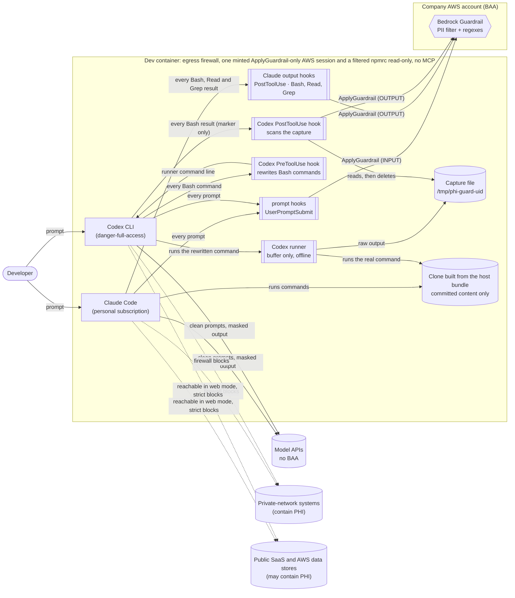
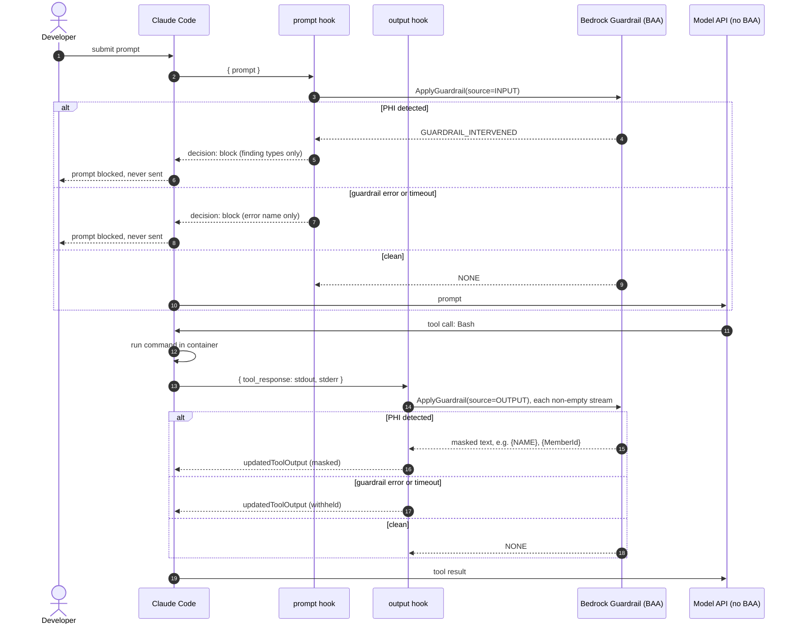
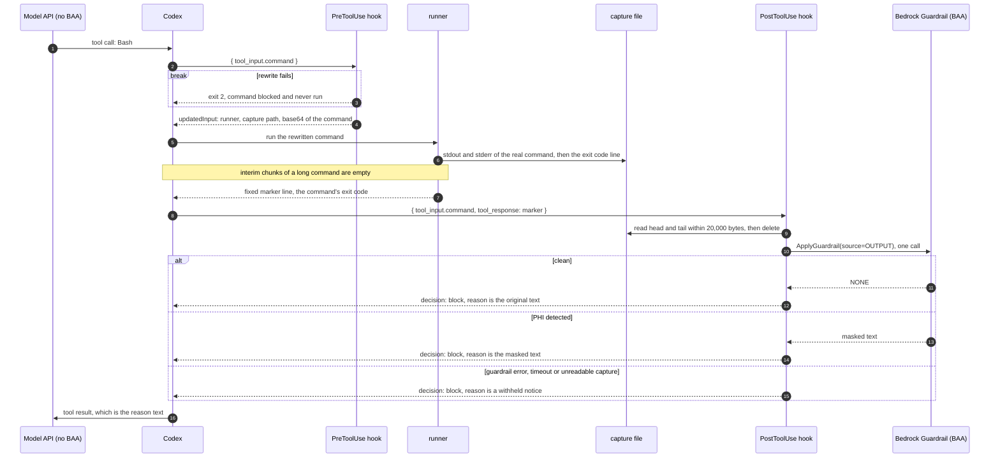

# phi-guard architecture

phi-guard lets a developer use a coding agent whose provider has no BAA, on
code-only work, without PHI reaching that provider. It supports Claude Code and
OpenAI Codex CLI. The sandbox does most of the work. The hooks catch the human
mistakes the sandbox can't, such as pasting a log line.

The hooks run as the same user as the agent, so they are a safety net against
accidents. [Same-uid tampering](#same-uid-tampering) says what that user can defeat,
and Failure behavior below says where each failure fails open.

## Components and trust boundaries

Codex gets a different output path from Claude Code because of how its hooks
behave (observed on Codex CLI 0.162.1):

- A PostToolUse hook cannot rewrite a result in place. `updatedToolOutput` is
  ignored. A `decision: "block"` reply replaces the tool result with its `reason`.
- A command that runs long returns interim output chunks to the model with no
  hook. Codex does not let this be turned off.

So phi-guard never lets command output reach Codex's own output channel. The
PreToolUse hook rewrites every shell command into a call to a runner. The runner
writes the command's stdout and stderr to a capture file and prints one fixed
marker line. The PostToolUse hook reads the capture, scans it, and replaces the
marker with the masked text. The runner is offline: it imports no AWS SDK and reads
no config, because it runs inside Codex's command sandbox. Only the hooks scan.

## Clean room

The claim phi-guard can defend is structural: the sandbox holds no PHI and can reach no
system that holds PHI. The guardrail is defence in depth for the one channel that cannot
be closed structurally, a human typing or pasting. This section lists what the sandbox
holds, what it can reach, how each statement is verified and what remains. It applies to
terminal `nophi` sessions only; attaching an editor is outside it.

**What the sandbox holds.**

- One AWS session credential, minted by `nophi` for a role whose only permission is
  `bedrock:ApplyGuardrail` on the guardrail. No SSO token, no `~/.aws/config`, no other
  role.
- An npmrc with the CodeArtifact `registry=` lines and those hosts' tokens. No other
  registry token and no GitHub or SSH credential.
- Committed content: a clone built from a bundle of the host repo's branches, tags and
  `HEAD`. No untracked or ignored files, no stash, no unreferenced objects.
- The personal agent logins on the `phi-guard-claude-config` and `phi-guard-codex-config`
  volumes, which are separate from the host's `~/.claude` and `~/.codex`.

**What it can reach.** In the default `strict` mode, by IP address: the agent providers,
GitHub's published ranges, npm and CodeArtifact, and the Bedrock runtime endpoint of the
configured region, plus the resolvers in the container's `/etc/resolv.conf` and the host's
/24. Everything else, including private ranges, is rejected. `web` and `off` are explicit
opt-ins that widen this (see Firewall modes).

**How each statement is checked.**

| Statement | Evidence |
|---|---|
| The credential can only call `ApplyGuardrail` | The IAM policy document (`ApplyGuardrailPolicy` in `infra/guardrail.yaml`). `nophi` cannot prove a profile is least-privilege |
| Egress is limited to the allowlist | The firewall's rule output at container start, and its argument pin: a later run with other arguments exits before touching a rule (see Container table) |
| The image holds what the Dockerfile says | The image is built from `.devcontainer/Dockerfile`; managed settings, `requirements.toml`, the firewall and the hooks are root-owned |
| Only committed content entered | `nophi` runs `git bundle create --branches --tags HEAD` in the host repo; the sandbox clones from that file |
| What comes back is untampered by redirection | The host copies one file out of the sandbox-writable `out/` and trusts only the copy, after checking it is a regular file starting with a bundle signature. The host repo's `nophi` remote points at that copy with `--no-tags` |

**Residuals.**

- Keyboard paste and images: a human can type or paste PHI into a prompt, and no hook sees
  an image. The hooks are the only layer there, and detection is limited.
- Same-uid tampering and `LD_PRELOAD`: the agent runs as the same user as the hooks (see
  Same-uid tampering).
- `web` and `off`: an engineer who opts in accepts the wider reach those modes document.
- Repo history and LFS: the bundle carries every reachable commit, so PHI committed in the
  past enters. LFS pointers enter without their objects.
- CodeArtifact token scope: the token reaches whatever its own permissions allow.
- Network: the host's /24; shared CDN and object-store addresses behind an IP allowlist,
  which admit other tenants of those addresses; allowlist IPs that went stale; recursive DNS
  through the allowed resolver, a low-bandwidth channel to any domain's name servers; IPv6,
  which the firewall does not filter if the Docker network provides it (see the IPv4 only
  row in the Container table).
- `nophi` cannot prove least privilege; the IAM policy document is the proof.
- Merged sandbox commits are untrusted code. The host runs nothing from the sandbox until
  the engineer merges its commits, and then hook directories, `.envrc` and
  `.vscode/tasks.json` run with the engineer's credentials.
- A container created without `nophi` never starts, because its mount sources are missing.
  A `nophi` container restarted with `docker start` has no firewall until `nophi` runs it
  again; its credentials, if not yet deleted, allow `ApplyGuardrail` only.
- Nested repos and submodules are not bundled, so they are not in the sandbox.

## Request flow

Claude Code:

Files reach Claude Code's model by two more paths, both scanned:

- **Read and Grep.** A second PostToolUse hook (`dist/file-output.mjs`, matcher
  `Read|Grep`) scans the file text in `tool_response` (`file.content` for Read,
  `content` for Grep) and replaces it with the masked text, as the Bash hook does.
  A Read result whose `type` is not `text` (an image or a PDF, for example) is withheld,
  because only text can be scanned. Observed on Claude Code 2.1.296: both result shapes,
  and that `updatedToolOutput` replaces both. Grep's file names are not scanned.
- **`@file` mentions.** Claude Code attaches a mentioned file's contents to the prompt
  without a tool call, and the UserPromptSubmit hook receives only the prompt text and
  `cwd` (observed). The Claude prompt hook therefore resolves each `@path` and
  `@"path"` against `cwd` (`~/` against the home directory), drops a `#L10-20` range
  and trailing punctuation, and scans each file it finds alongside the prompt. A file
  over 1,000,000 bytes, or one holding a NUL byte, blocks the prompt. A mention that
  names no file (a directory, a handle, a missing path) is skipped.

Codex. The prompt path matches Claude Code's. Commands go through the wrapper:

The hook scans one bounded capture per command. PostToolUse shows the model at
most 20,000 bytes (`BUDGET_BYTES`): the first and last ~9,950 bytes of the
capture, with an omitted-bytes line between them. The rest is withheld. Everything
shown was scanned. If PreToolUse failed open and the command ran unwrapped,
PostToolUse scans `tool_response` directly.

## What covers which path

| Way PHI could reach the model | Control | Claude Code | Codex |
|---|---|---|---|
| Live systems at private addresses (10/8, 172.16/12, 192.168/16, 100.64/10, 169.254/16), such as internal DBs and VPN-only tools on private IPs | Container egress firewall | Covered, for IPv4, in web and strict modes | Covered, for IPv4, in web and strict modes |
| Public SaaS (Jira cloud, Datadog) | Container egress firewall, and the container holds no credentials for them | Reachable in web mode, covered in strict mode | Reachable in web mode, covered in strict mode |
| Host secrets and config other than the exchange directory's two credential files (`~/.ssh`, the host `~/.aws` and its SSO token, MCP config) | Container boundary | Covered | Covered |
| PHI data stores reached with the sandbox's AWS credential | The credential itself, one session for a role whose only permission is `bedrock:ApplyGuardrail` on the guardrail, then in strict mode the egress firewall | Covered by the role's permissions in every mode, if the role is least-privilege (the IAM policy document is the proof, and `nophi` cannot check it). In strict mode also covered by the firewall, for IPv4, unless the store's host is listed in `PHI_GUARD_EXTRA_HOSTS` | Same as Claude Code |
| Committed fixtures and history | Policy: no PHI committed. Only committed, reachable content enters the sandbox (a bundle of branches, tags and `HEAD`), so untracked and ignored files, the stash and unreferenced objects stay on the host | Covered by policy | Covered by policy |
| Text the developer types or pastes | Prompt hook (block) | Covered, limited by detection | Covered, limited by detection |
| Command output (tests, scripts) | Output hook (mask) | Covered for the `Bash` tool, limited by detection | Covered for the `Bash` tool through the wrapper, limited by detection |
| Files read with the Read or Grep tool | File output hook (mask) | Covered for the file text, limited by detection. File names in Grep and Glob results are not scanned | A file read through a shell command is command output and is scanned. No claim is made for other read paths |
| `@file` mentions | Prompt hook (block) | Covered, limited by detection, for mentions the hook can resolve to a file (see Request flow) | No claim is made |
| Pasted screenshots, images | None (no hook sees images) | **Gap**: policy only | **Gap**: policy only, including images opened with `view_image` |
| Other tools | Hook matchers | Only `Bash`, `Read` and `Grep` output is scanned. `Edit` and `Write` results are not, and the file snippet Claude Code shows the model after an edit can hold lines that a masked Read hid (inferred, not observed) | The `^Bash$` matcher does not see other tools: for example `apply_patch`, `view_image`, other local function tools, and extension or MCP tools, which hook under `mcp__<server>__<tool>` names |
| Commands the user runs themselves with `!` | None | n/a | **Gap**: Codex runs them with no hooks, and their output enters the context |
| Shell-like MCP tools | Container config | Allowlist of none configured | Allowlist of none configured |

Neither MCP setting was exercised with a real MCP server in Part 1.

Codex's documentation calls tool hooks "a useful guardrail, not a complete
enforcement boundary", because some specialized tool paths can opt out of the hook
path. Hosted tools such as web search use no hook path.

WebSearch and Codex web search are believed to run on the provider's servers, so the
container's firewall does not carry that traffic (not verified). WebFetch and `curl`
run in the container and work in web mode.

## Firewall modes

`PHI_GUARD_FIREWALL` selects the mode. The README's [Install](../README.md#install)
section says how to set it.

| Value | Egress |
|---|---|
| `web` | Any public IPv4 address. After the DNS, SSH, loopback and host-network accepts, the firewall rejects `10.0.0.0/8`, `172.16.0.0/12`, `192.168.0.0/16`, `100.64.0.0/10` and `169.254.0.0/16` (the last holds the cloud metadata service), then accepts all other outbound traffic. Web searches, WebFetch and `curl` to public sites work. It makes no DNS lookups for an allowlist and reads no region, so it needs no guardrail configuration. Its self-test expects `https://api.github.com/zen` to answer and `http://169.254.169.254/` to fail |
| `strict` (default) | An allowlist: GitHub's published ranges, `registry.npmjs.org`, the Anthropic hosts (`api.anthropic.com`, `claude.ai`, `claude.com`, `platform.claude.com`), the OpenAI hosts Codex needs (`api.openai.com`, `chatgpt.com`, `auth.openai.com`) and `bedrock-runtime.<region>.amazonaws.com`. Hosts derived from the mounted npmrc (the CodeArtifact registries) and every `PHI_GUARD_EXTRA_HOSTS` entry are added (see the Container table). The reference's Sentry and Statsig telemetry hosts are dropped, and so are the VS Code hosts, because only terminal `nophi` sessions are supported. There is no STS or SSO host, since nothing in the container performs SSO or calls STS. DNS (UDP and TCP 53) goes only to the IPv4 nameservers in the container's `/etc/resolv.conf`, and there is no blanket SSH accept: SSH reaches only allowlisted addresses and the host network. Codex hosts seen rarely in its source (`ab.chatgpt.com`, `files.openai.com`) are not allowed, and Part 2 checks whether Codex login needs them. A listed host is reachable with the sandbox's one credential |
| `off` | No firewall. The live-systems rows above become the user's responsibility |

Strict is the default. `web` is an explicit opt-in that treats public web traffic as
PHI-free, and the sandbox's one credential makes accidental PHI access through AWS very
hard in every mode. The hooks never read `PHI_GUARD_FIREWALL`. `devcontainer.json` passes
it from the host environment into the container, default `strict`, and the value is fixed
when the container is created.
The exact value `off` makes `postStartCommand` skip the firewall script. Any other
value goes to the script as its first argument (`PHI_GUARD_EXTRA_HOSTS` is the
second). The script accepts only `web` and `strict` and exits before it changes a
rule on anything else. The firewall writes no IPv6 rules (see the IPv4 only row in
the Container table).

The script pins both arguments. The first run writes the mode and the extra-hosts string
to `/etc/phi-guard/firewall-args` (root-owned, in the container layer, so it survives
`docker start` and `--rebuild` discards it), and a later run with different arguments exits
before it touches a rule. Identical arguments continue, which is how the script runs at
every container start. In strict mode the script also reads the nameservers from
`/etc/resolv.conf` and exits when there is no IPv4 one, before it flushes anything.

Strict mode resolves DNS once, when the script starts. To refresh the allowlist after
an IP rotation, restart the container: `postStartCommand` re-runs the script in a
fresh network namespace, and re-running it in place is not supported.

## Failure behavior

Claude Code:

The output hook column covers both PostToolUse hooks: Bash, and Read and Grep.

| Failure | Prompt hook | Output hook |
|---|---|---|
| Guardrail flags PHI | Blocks the prompt | Masks the values |
| AWS error, throttling, bad credentials | Blocks (own catch) | Withholds output (own catch) |
| The Bedrock call takes longer than 10s (an AbortSignal on the HTTP request) | Blocks | Withholds |
| Own 15s deadline (credential resolution or stdin hangs; the AbortSignal covers only the HTTP request) | Blocks | Withholds |
| `tool_response` has an unexpected shape (Bash without `stdout` and `stderr` strings, Read without a `file.content` string, Grep `content` that is not a string) | n/a | Withholds (`InvalidHookInput`) if Claude Code accepts the replacement shape (next row) |
| Text over the size quota. In us-east-1 the API rejects it with `ThrottlingException` (observed). A response that reports fewer guarded characters than were sent becomes `PartialGuardrailCoverage` | Blocks | Withholds |
| The response omits `guardrailCoverage`, so a partial scan cannot be seen (every Part 2 response carried it) | **Fails open** for that prompt | **Fails open** for that output |
| An `@`-mentioned file is over 1,000,000 bytes or holds a NUL byte | Blocks (`AttachmentTooLarge`, `UnscannableAttachment`) | n/a |
| A Read result is not text (an image, a PDF) | n/a | Withholds |
| Hook crashes, or is killed at the 20s hook timeout (the 15s deadline makes a kill unlikely) | Blocks (`onFailure: "block"`) | **Fails open**: `onFailure` can't withhold PostToolUse output |
| Replacement output has the wrong shape | n/a | **Fails open**: Claude Code ignores it. The hook spreads the original fields, and `scripts/e2e.sh` checks this |
| Claude Code started without the wrapper under an org login (see [Org logins](#org-logins)) | **Fails open**: the plugin is not loaded | **Fails open** |
| Same-uid tampering (see [Same-uid tampering](#same-uid-tampering)) | **Can fail open** for every later prompt in the session. A substituted `node` that exits 0 with no output is not a failure | **Can fail open** for every later command in the session |

The crash-or-kill row is why the output hook is bundled with no runtime
dependencies, and why its own 15s deadline sits under the 20s hook timeout. The
Claude hooks use the exec form (`command: "node"` plus `args`), so no shell
reads startup files for them. That is inferred from the hook form and has not
been verified.

Codex, by hook. Codex has no `onFailure`, and every hook failure fails open at the
host level except exit 2. Every command in `hooks/codex-hooks.json` is therefore
`node <entrypoint> || { echo '<message>' >&2; exit 2; }`, and each entrypoint has
its own 15s deadline under the 20s hook timeout.

| Failure | Prompt hook | PreToolUse (wrapper) | PostToolUse (scan) |
|---|---|---|---|
| Guardrail flags PHI | Blocks the prompt | n/a | Replaces the result with the masked text |
| AWS error, throttling, bad credentials, missing config | Blocks (own catch) | n/a, it reads no config | Withholds (own catch) |
| The Bedrock call takes longer than 10s (an AbortSignal on the HTTP request) | Blocks | n/a | Withholds |
| The guardrail scanned fewer characters than were sent | Blocks (`PartialGuardrailCoverage`) | n/a | Withholds (`PartialGuardrailCoverage`) |
| The response omits `guardrailCoverage` (unverified) | **Fails open** for that prompt | n/a | **Fails open** for that output |
| Own 15s deadline (credential resolution or stdin hangs) | Blocks | Exit 2: the command is blocked and never runs | Withholds |
| Entrypoint exits non-zero (crash, `node` missing) | Exit 2 guard blocks | Exit 2 guard blocks the command | Exit 2 guard blocks |
| Capture file missing, unreadable, or unsafe (symlink, other owner, extra hard links, not a regular file) | n/a | n/a | Withholds, naming the cause |
| Runner cannot create the capture | n/a | n/a | The runner prints a withheld notice naming the cause and exits non-zero |
| Command arrives unwrapped (PreToolUse failed open) | n/a | n/a | Scans `tool_response` itself |
| Codex kills a hook at its 20s timeout | **Fails open**: the prompt is sent unscanned | **Fails open**: the original command runs unwrapped | **Fails open**: the final chunk reaches the model as it is |
| Hook stdout is not valid JSON, for example because the shell or its startup files printed something | **Fails open** | **Fails open** | **Fails open** |

What a PostToolUse timeout kill or JSON corruption exposes is whatever the
command's final chunk carried. For a wrapped command that is only the fixed
marker, and the output stays in the capture file. For an unwrapped command it is
the raw output. A PreToolUse failure that runs a long command unwrapped also
sends its interim chunks to the model with no hook at all.

Codex residuals. Each of these is outside what the guard and the deadline can
close.

| Residual | Effect and breadth |
|---|---|
| Codex-side timeout kill (any event) | See the table above. The 15s own deadline makes it unlikely. It cannot be closed from inside the hook |
| Shell or profile output corrupting hook JSON | Codex runs a hook command through a shell with `-c`. Observed in the container, it is the passwd shell of user `node` (bash, with `SHELL` set to zsh and to sh), which reads no startup files. Anything that shell prints before the hook runs corrupts the hook's JSON and makes the hook fail open. Applies to all three events, every turn |
| Shell startup files and `PATH` | A Codex hook command is a shell string, so a shell startup file or a `PATH` change can subvert it. Where the passwd shell is zsh, a non-login `zsh -c` reads `~/.zshenv`, and a login invocation (`zsh -lc`) also reads `~/.zprofile` and `~/.zlogin`. A file that prints, runs `exit 0`, shadows `node` or changes `PATH` turns the hook into a no-op, because the guard catches only non-zero exits. Under `danger-full-access` the agent can write those files. Applies to all three events, every later turn and session. In the container the passwd shell is bash, which reads none of them, so this path is open for a host install whose passwd shell is zsh. A `PATH` prepend in `~/.profile` still affects Codex sessions launched from a bash login terminal (demonstrated). `ZDOTDIR=/etc/zsh` would redirect a zsh passwd shell to root-owned files, but it does not protect the Codex hooks while the passwd shell is bash |
| A competing PreToolUse hook that rewrites commands | The last rewrite wins, so a command can reach Codex unwrapped. A short command is then scanned by PostToolUse. A long-running one sends interim chunks to the model with no hook. In the container, `allow_managed_hooks_only` skips plugin and user hooks (from the Codex source, not observed) |
| Same-uid tampering | Can make all three hooks fail open. See [Same-uid tampering](#same-uid-tampering) for the Codex-specific paths |
| Interrupted commands | Codex SIGKILLs the runner's process group. The command's own process runs detached in its own session, which keeps it from writing to `/dev/tty`, so it survives and keeps writing to its capture file. Its output still never reaches the model |
| Abandoned capture files | A capture that PostToolUse never reads (an interrupted command, a command whose detached child is still writing, a killed PostToolUse hook) stays in `/tmp/phi-guard-<uid>` holding raw, unscanned output until someone removes it. The directory is mode 0700 |
| Approval prompts and approval rules | They see `'<node>' '<runner>' '<capture path>' <base64>`, not the original command |
| `apply_patch` through the shell | The exec-based `apply_patch` interception is lost, because Codex no longer sees the original command |
| Very large commands | The base64 form exceeds the per-argument limit (about 128 KiB on Linux): the command fails with E2BIG and does not run. This fails closed |
| Interactive and tty commands | Output arrives only at exit |
| Interleaving and shell | The runner captures stdout and stderr into one interleaved file, and runs the command as a non-login `$SHELL -c` (Codex's login flag is lost) |
| Read-only sandbox, or `exclude_slash_tmp` | The runner cannot write its capture, so every command's output is withheld. This fails closed. phi-guard needs a Codex sandbox that allows writes to `/tmp`: workspace-write or danger-full-access |
| User `!` commands | Run with no hooks, and their output enters the context (see the coverage table) |
| MCP and other non-Bash tools | Not matched (see the coverage table). The container configures an MCP allowlist of none |

Container:

| Residual | Effect and breadth |
|---|---|
| AWS endpoint IPs rotate (strict mode) | The strict firewall resolves DNS once, when it starts. After a rotation the Bedrock calls fail, so the hooks fail closed (prompts blocked, output withheld) until the container is restarted. A stale allowlist entry can also point at an address another party now uses (inferred, not verified) |
| Strict mode needs a real region and a resolver | It reads `aws_region` from the managed Claude settings, which the image build writes from `PHI_GUARD_AWS_REGION` (the build fails when it is empty). The script exits before changing any rule if the value is not a region name or does not resolve, or if `/etc/resolv.conf` has no IPv4 nameserver, and then the strict container runs without a firewall. Web mode reads neither. A wrong but well-formed region makes every scan fail, so the hooks fail closed |
| The firewall script fails midway | It flushes the rules, then (in strict mode) resolves hosts, then switches the default policies to DROP. A failure in between leaves egress open until a later run succeeds |
| IPv4 only | The firewall writes no IPv6 rules. If the Docker network gives the container IPv6, all IPv6 egress is unfiltered. Docker's default bridge has no IPv6 |
| Reference firewall rules that stay | In web mode, outbound DNS (UDP 53) to any resolver and outbound SSH (TCP 22) to any host stay, as in Anthropic's reference, and they come before the private-range rejects, so DNS and SSH also reach private addresses. In both modes the host's /24 network is allowed, although it usually sits inside a rejected range. In strict mode DNS goes only to the resolvers in `/etc/resolv.conf` and SSH only to the allowlist and the host's /24 |
| DNS through the allowed resolver (strict mode) | The resolver recurses for any name, so a lookup of `<data>.attacker.example` reaches that domain's name servers: a low-bandwidth channel to any domain. The `lo` accepts that Docker's embedded resolver at 127.0.0.11 needs stay. Closing this needs a filtering resolver, which is out of scope |
| VPN-gated services at public addresses (web mode) | A service that admits the VPN's source IP at a public address, or an internal name that resolves to a public address, is reachable when the host routes container traffic through its VPN. Its own authentication is then the only gate. Strict mode blocks it |
| Web mode allows any public host | A tool or agent can send data to any public site. That matters only if PHI reached the context, which is what the hooks prevent. Public SaaS is reachable, and the container holds no credentials for it |
| The firewall arguments are pinned | `node` may run `sudo /usr/local/bin/init-firewall.sh` with any argument, but the script records its first arguments in the root-owned `/etc/phi-guard/firewall-args` and a run with different ones exits before it changes a rule. The agent can therefore neither switch a strict container to `web` nor widen the allowlist through the extra-hosts argument. A run with the same arguments rebuilds the same rules. The script's two test overrides (`FIREWALL_ARGS`, `RESOLV_CONF`) cannot be passed through sudo: the image keeps `Defaults env_reset` (checked in the built image) and the sudoers rule has no `SETENV`. A container created with `PHI_GUARD_FIREWALL=off` never runs the script at start and so has no pin, and its egress is open anyway |
| `PHI_GUARD_FIREWALL=off` | No egress boundary at all. A value other than `web`, `strict` and `off` makes the script exit before it changes a rule, which leaves the container without a firewall and `postStartCommand` failing (see Firewall modes) |
| `/home/node` is writable by the agent | This covers agent state and any shell startup files. The credential files at `~/.aws` and `~/.npmrc` are read-only mounts (see the next rows). Endpoint redirection through a profile's `endpoint_url` or `AWS_ENDPOINT_URL*` is neutralised by endpoint pinning |
| The agent can read the sandbox's credentials | `devcontainer.json` mounts the launcher's exchange directory read-only: `in/aws` at `~/.aws`, holding one `credentials` file with a session for the `ApplyGuardrail` role, and `in/npmrc` at `~/.npmrc`, holding only CodeArtifact `registry=` lines and those hosts' tokens. The host `~/.aws` (profiles, SSO token cache) is never mounted, so no other role is reachable. The agent can use the session for `bedrock:ApplyGuardrail` on the guardrail until its `Expiration` (an hour by default; `nophi down` deletes the file, closing a session does not). `nophi` cannot prove the profile is least-privilege, and the IAM policy document (`ApplyGuardrailPolicy`) is the proof. The CodeArtifact token reaches whatever its own permissions allow. A credential the agent reads or prints, for example while debugging npm auth, lands in the model provider's transcript |
| Read-only credential mounts | Both mounts are `readonly`, so the agent cannot edit the credentials or the npmrc. The sandbox has no `~/.aws/config`, so there is no `credential_process` to plant and no SSO token cache. `nophi` refreshes the credentials by writing a temp file inside `in/aws` and renaming it, which a running container sees through the directory mount, and each hook is a fresh process that reads the file again. `in/npmrc` is a file mount, so `nophi` rewrites it in place, because a rename would leave a reused container holding the old inode |
| Derived firewall hosts are read at start (strict mode) | The strict firewall reads the host of each CodeArtifact `registry=` URL in the mounted npmrc and the hostnames in `PHI_GUARD_EXTRA_HOSTS`. Entries that are not valid are skipped with a warning, and a host that does not resolve is skipped with a warning. All of this is read once, when the script starts, so a changed `~/.npmrc` needs a container restart. `PHI_GUARD_EXTRA_HOSTS` is fixed when the container is created, and the script pins it |
| Expired AWS session | `nophi claude` and `nophi codex` stop at launch when the host profile cannot mint a session. A session that expires while the sandbox runs makes the scan fail with bad credentials, so prompts are blocked and output is withheld (fail closed) until the engineer reruns `nophi` |
| Repo-shipped enforcement | `bin/nophi` runs on the host from its own payload (a checkout of this repo, or the Homebrew libexec copy), and the image is built from that payload's `.devcontainer/`, so a repo being worked on does not supply its own enforcement. The working tree is no longer mounted. An edited payload (`bin/nophi`, `devcontainer.json`, an added `initializeCommand`) runs on the host with the engineer's credentials at the next launch. An editor's "Reopen in Container" on a repo runs that repo's `initializeCommand` on the host before Docker rejects the missing `NOPHI_EXCHANGE` mount sources. Sandbox commits merged on the host are untrusted code. Review payload changes before running `nophi` from a modified checkout. Policy that engineers must not bypass belongs in server-managed settings or MDM |
| Same-uid tampering | Anything that runs as uid `node`, and any repo or user settings `env`, can make the hooks fail open (both agents). See [Same-uid tampering](#same-uid-tampering) |
| Reference devcontainer license | The Dockerfile, `devcontainer.json` and `init-firewall.sh` are adapted from Anthropic's reference (© Anthropic PBC, subject to Anthropic's Commercial Terms of Service). Attribution is kept in each file header and in `.devcontainer/LICENSE-anthropic-reference.md` |

## Same-uid tampering

The hooks share the agent's uid, so they stay a safety net against mistakes. Anything
that runs as that uid (the agent, a command it runs, a committed repo file the agent
loads) and any project or user settings `env` can alter the hooks' inputs and make
them fail open, for every later prompt and command in the session. A separate uid for
the hooks would be the real fix and is out of scope. The failure tables and the
Container table link here for this class.

- **Claude Code.** Demonstrated: project `.claude/settings.json` `env.LD_PRELOAD`,
  which needs only a committed repo file, and `PATH` and `NODE_OPTIONS` before they
  were pinned. Likely, not run: `env` `AWS_CONFIG_FILE` or credential variables
  pointing at a guardrail the agent controls (the sandbox holds no host `~/.aws/config`
  to redirect to), user-level agent config, and a killed hook process. A substituted `node` that exits 0 with no output is not a failure.
- **Codex.** Killing a hook's `node` process trips the exit-2 guard and fails closed.
  Killing the hook's shell fails open for that one prompt or command.
  `[features] hooks = false` in a user `config.toml` turns off all three hooks for
  every later session (the container pins `hooks = true` in `requirements.toml`). A
  `PATH` prepend or a startup file changes which `node` runs (see the shell startup
  files row of the Codex residuals). Likely, not run: `AWS_CONFIG_FILE` or credential
  variables pointing at a guardrail the agent controls.
- **Container.** Managed Claude `env` pins `PATH` and `NODE_OPTIONS` and closes those
  two variables only. The environment is not locked down: other variables, such as
  `LD_PRELOAD` in a project's `.claude/settings.json` `env`, still reach the hooks.

## Configuration and enforcement

The settings, their Claude Code `userConfig` keys and their Codex environment
variables are listed in the README's [Configuration](../README.md#configuration) table.

One reader serves both agents. The Claude entrypoints read only
`CLAUDE_PLUGIN_OPTION_*` and the Codex entrypoints read only `PHI_GUARD_*`. A missing
required value fails with the named error `MissingGuardrailConfig`, which blocks
the prompt or withholds the output. Codex has no plugin options, so its hooks
inherit the variables from the Codex process environment.

**Claude Code.** Plugin options live under `pluginConfigs` in settings, in user or
managed scope. The devcontainer ships `/etc/claude-code/managed-settings.d/phi-guard.json`.
It registers the plugin directory `/opt/phi-guard` as a marketplace
(`extraKnownMarketplaces`), force-enables `phi-guard@phi-guard`, sets
`pluginConfigs`, sets `permissions.disableBypassPermissionsMode: "disable"`, and
sets `allowManagedMcpServersOnly` with an empty `allowedMcpServers`,
`allowManagedHooksOnly`, and the `env` pins described above. An org login replaces
that file, and [Org logins](#org-logins) says how the image keeps the plugin loaded.

**Codex.** Plugin hooks need the user to review and trust them (trust is recorded
against the hook's hash), and `allow_managed_hooks_only` skips them (from the Codex
source, not observed). The
devcontainer therefore ships the same hooks as managed hooks: inline `[hooks]` in
`/etc/codex/requirements.toml`, auto-trusted and not disableable by the user, with
`allow_managed_hooks_only = true`, `[features] hooks = true`, an empty
`[mcp_servers]` table, and `allowed_approval_policies` of `untrusted` and
`on-request`. `test/devcontainer.test.ts` keeps these commands in step with
`hooks/codex-hooks.json`. `/etc/codex/managed_config.toml` sets
`sandbox_mode = "danger-full-access"` and `approval_policy = "on-request"`. Codex
applies its `approval_policy` as a constraint: in the built image the only
selectable approval policy is `on-request`, so `untrusted` from
`allowed_approval_policies` cannot be chosen either. Its `sandbox_mode` stays a
default: `codex exec -s read-only` runs with `sandbox: read-only`. Every
`codex exec` prints a warning that its non-interactive default (`never`) fell back
to `on-request`.

**Endpoint pinning.** The client is created with `ignoreConfiguredEndpointUrls: true`.
`AWS_ENDPOINT_URL*` environment variables and a profile's `endpoint_url` cannot
redirect scans to a fake answer. The region goes to the SDK, which rejects an
invalid one.

**Observed in Part 1** (Docker, Claude Code 2.1.296, Codex CLI 0.162.1, no login):

- Unverified item 6. With `allowManagedHooksOnly: true`, an unauthenticated
  `claude -p hi` in the built image fired the force-enabled managed plugin's
  UserPromptSubmit hook, and the `pluginConfigs` options reached it: the block reason
  carried an `errorName` other than `MissingGuardrailConfig`.
- Codex analog. Inline managed `[hooks]` in `requirements.toml` fire under
  `allow_managed_hooks_only`.
- `disableBypassPermissionsMode: "disable"` downgrades
  `--dangerously-skip-permissions` to `auto` mode, and the flag is accepted.
- Codex `--yolo` and `-c approval_policy=...` fall back to `on-request` with a
  warning that names `/etc/codex/managed_config.toml` as the constraint.

## Org logins

A company login can bring its own managed policy, which displaces the container's.

**Claude Code.** Managed settings are first-wins: when a Team or Enterprise login
fetches the org's server-managed settings, they replace the managed settings files
under `/etc/claude-code/managed-settings.d/`. Only a few keys merge across managed
sources, and the `managedSourcesBehavior: "merge"` opt-in is read only from the
highest-ranked source, so a file cannot opt itself back in (from the Claude Code
settings documentation). Observed on 2.1.296 with an Enterprise login: phi-guard was
not loaded, no hook ran, the status line was gone, and a fake-PII prompt reached the
model. With an empty `CLAUDE_CONFIG_DIR`
the same image loaded the plugin.

The image closes this with a wrapper. `/usr/local/bin/claude` is
`.devcontainer/claude.sh`, which runs the CLI with `--plugin-dir /opt/phi-guard` and
`--settings /opt/phi-guard/claude-settings.json`. The Dockerfile derives that file
from the managed settings: the same `env` pins, `permissions`, `statusLine`, and the
plugin options under `pluginConfigs["phi-guard@inline"]`, the id a `--plugin-dir`
plugin reads. Command-line settings rank below managed settings and above user,
project and local settings. Observed on 2.1.296:

- Under the Enterprise login the wrapper loads the plugin and its options. The prompt,
  `@file`, Read, Grep and Bash paths all blocked or masked the fake PII.
- Under the managed file alone (a personal login, or none) the two sources register as
  one `phi-guard@phi-guard`, and each hook runs once.
- A wrong options key fails closed (`MissingGuardrailConfig`).

Under an org login the managed-only keys in the phi-guard file (`allowManagedHooksOnly`,
the empty MCP allowlist, the marketplace entry) give way to whatever the org sets. If the
org sets `allowManagedHooksOnly`, the command-line plugin's hooks do not load (inferred,
as for `pnpm e2e` in the README). The
launcher's health check catches that, as it does any other way the hooks go missing:
before the agent starts, `nophi` sends a fake-PII canary prompt through the real
`claude` and passes only when phi-guard blocks it before any model call (`total_cost_usd`
0). The prompt hook runs before authentication, so the check also works before the
first login.

Residuals:

- **Other ways to start Claude Code.** Only `/usr/local/bin/claude` carries the flags.
  Running the CLI binary by its full path, through `npx`, or from an editor extension
  that ships its own binary (the VS Code extension does) bypasses the wrapper. Under an
  org login those sessions run without phi-guard. This is same-uid action (see
  [Same-uid tampering](#same-uid-tampering)), and `nophi` launches only through the
  wrapper.
- **A login made inside a running session.** The canary runs once, at launch. The
  wrapper's flags still apply after a mid-session `/login`, and an org that sets
  `allowManagedHooksOnly` is caught at the next `nophi` start (inferred, not observed).
- **Status line text.** It says `personal subscription sandbox` under any login.

**Codex.** A ChatGPT business or enterprise workspace login fetches cloud requirements,
which merge over `/etc/codex/requirements.toml` (from the Codex 0.162.1 source, not
observed). Managed hooks are append-only, so cloud requirements cannot remove phi-guard's.
Scalar keys such as `allow_managed_hooks_only` and `[features] hooks` can be set by the
cloud layer, so an org could turn hooks off (inferred from the source). `/debug-config`
shows the source of each requirement. The health check covers this too: when
`codex login status` reports a login, it runs the canary through `codex exec` and passes
only when the turn completes with zero token usage and no agent message. Signed out, only
the files apply, and it checks the guardrail alone. The Codex canary has run only against
stubs, because no Codex login was available in Part 2.

## Devcontainer notes

- **Ownership.** The CLIs (a root-owned global npm prefix), `/opt/phi-guard`,
  `/etc/claude-code`, `/etc/codex` and `/etc/zsh` are root-owned, so the agent
  cannot rewrite them. `/home/node` (shell startup files, agent state) and
  `/workspace` are writable by the agent. `/etc/phi-guard`, which holds the firewall's
  pin file, is root-owned too. The mounted `~/.aws` and `~/.npmrc` are read-only.
- **Login volumes.** `devcontainer.json` mounts the fixed-name volumes
  `phi-guard-claude-config` and `phi-guard-codex-config` at `/home/node/.claude` and
  `/home/node/.codex`. One sandbox login per machine is shared by every repo's
  container and stays separate from the host's `~/.claude` and `~/.codex`. phi-guard
  does not choose the login method.
- **Sandbox markers.** These markers show that a terminal is inside the sandbox.
  `runArgs` fixes the container hostname to `phi-guard-sandbox`, and the Codex status
  line in `codex/managed_config.toml` (`[tui]`) leads with the `hostname` item. The
  Codex terminal title is `activity` and `project-name` because the title has no
  hostname item. Managed settings point Claude Code's `statusLine` at the root-owned
  `/opt/phi-guard/statusline.sh`, which prints `NO PHI`, the subscription note and
  `PHI_GUARD_FIREWALL` (`strict` when unset). `/opt/phi-guard/sandbox-banner.sh` is
  appended as a source line to `/etc/zsh/zshrc` and `/etc/bash.bashrc`. In interactive
  shells it prints a three-line banner that opens with `NO PHI IN THIS SANDBOX.` and
  prefixes the prompt with `[NO PHI] `. Bash
  adds the prefix through `PROMPT_COMMAND` because `~/.bashrc` sets `PS1` after the
  system file. The banner returns early unless `$-` contains `i`, so the non-interactive
  `bash -c` and `zsh -c` shells that run hook commands print nothing. Whether
  Codex honours `[tui]` from `managed_config.toml` when it renders is unverified,
  because headless runs draw no TUI. The markers are
  a visual aid for the person at the terminal, and the agent can edit `~/.bashrc`.
- **Codex sandbox.** Codex runs with `danger-full-access`. The container is the
  boundary, as it is for Claude Code, which has no OS sandbox here either. Docker's
  default seccomp profile blocks the namespaces Codex's bubblewrap sandbox needs,
  and the project chose not to loosen Docker's isolation. The image carries no
  bubblewrap. `allowed_sandbox_modes` lists `read-only` and `danger-full-access`
  (Codex rejects a list without `read-only`). Read-only stays selectable and fails
  closed, as the Codex table says.
- **Sandbox credentials.** The host's `~/.aws` and `~/.npmrc` are never mounted, and
  `devcontainer.json` has no `initializeCommand`. It mounts the launcher's exchange
  directory (`${localEnv:NOPHI_EXCHANGE}`, exported by `nophi`): `in/aws` read-only at
  `~/.aws`, `in/npmrc` read-only at `~/.npmrc`, `in` read-only at `/nophi/in`, `out` at
  `/nophi/out`, and `workspace` as `/workspace` (`workspaceMount`; `workspaceFolder` stays
  set too, because the devcontainer CLI runs host git in the workspace folder when either is
  missing). `nophi` mints the one session
  credential on the host (see Launcher), and the hooks find it through the default
  credential chain, so the image configures no profile and `PHI_GUARD_AWS_PROFILE` is a
  host variable only. A container started without `nophi` has no `NOPHI_EXCHANGE`, its mount
  sources do not exist, and it never starts.
- **Guardrail values.** The public repo commits none. `devcontainer.json` passes
  `PHI_GUARD_GUARDRAIL_ID`, `PHI_GUARD_GUARDRAIL_VERSION` and `PHI_GUARD_AWS_REGION`
  from the host environment as build args. At the end of the Dockerfile a `RUN` fails the
  build when one is empty (it names the variables, never the values), a second `RUN`
  writes the three Claude `pluginConfigs` options (no `aws_profile`) into the root-owned
  managed settings with `jq`, and
  `ENV` lines give Codex the same values. Every way of building the image passes through
  that check, so no image ships with empty options. `test/devcontainer.test.ts`
  checks that the option keys, build args and `ENV` lines use the same names.
- **Shell.** `SHELL=/bin/zsh` and `ZDOTDIR=/etc/zsh` serve interactive terminals.
  Because zsh looks for its startup files in root-owned `/etc/zsh`, users'
  `~/.zshrc` and other dotfiles are ignored and zsh keeps no history (`HISTFILE` is
  unset). Codex runs hook commands through the passwd shell of user `node` (bash,
  observed), which neither variable affects.
- **Node.** The image and the bundles target Node 20. The AWS SDK's own warning
  says versions published after the first week of January 2027 require Node 22 or
  newer, so move the base image and the esbuild target before taking those
  versions.

## Launcher

`bin/nophi` wraps the `devcontainer` CLI around `.devcontainer/devcontainer.json`, which
stays the single source for mounts, capabilities, the firewall and env. It resolves the
payload directory through symlinks (a Homebrew install links into `libexec`), so the
config path it passes is absolute. `Formula/nophi.rb` installs the payload files the
Dockerfile copies plus `bin/`, and declares `awscli` and `jq`, so the repo doubles as its
own Homebrew tap.

- **Exchange directory.** `nophi` owns
  `${XDG_CACHE_HOME:-$HOME/.cache}/nophi/<repo name>-<first 8 hex of the SHA-1 of the repo root>/`
  (mode 0700 on every directory) and exports it as `NOPHI_EXCHANGE` before any
  `devcontainer` call. Under `in/` it writes `aws/credentials` (0600) and `npmrc` (0600), both
  as plain files. It never executes, follows or parses anything the sandbox wrote there.
- **Minting.** For `claude` and `codex`, before `up`, `nophi` runs `aws configure
  export-credentials --profile 
 --format process`, with `
` taken from
  `PHI_GUARD_AWS_PROFILE` (unset or empty means `phi-guard`), and pipes the JSON through
  `jq` into a temp file in `in/aws` that it renames to `credentials`. The conversion
  requires `SessionToken` and `Expiration` as well as the key pair, which refuses long-lived
  static keys. The values travel through the pipe only: not argv, not the launcher log, not
  the terminal. A failed export stops the launch with a hint to run `good-morning` (`aws sso
  login`), and no credentials file is written. For `shell` and `codex login` it warns and
  continues. Credentials are deleted by `nophi down`, not when a session exits, because a
  second `nophi` in another terminal (the documented refresh, and `shell`) would otherwise
  strip a running session.
- **npmrc filter.** At every launch `nophi` rewrites `in/npmrc` in place from the host
  `~/.npmrc`, keeping the `registry=` and `@scope:registry=` lines whose host matches
  the CodeArtifact pattern, and the `//<that host>/...:_authToken=` lines for those hosts.
  It gets the hosts from the firewall script's own parser, sourced in a subshell (the
  script's guard returns before any rule). Everything else, such as another registry's token
  or a GitHub Packages PAT, stays on the host. A missing `~/.npmrc` gives an empty file.
- **Id labels and legacy containers.** New containers carry the labels `nophi.schema=3`
  and `nophi.repo=<repo root>`. In devcontainer CLI 0.89.0 id labels replace the default
  `devcontainer.local_folder` and `config_file` labels, so `up`, `exec` and `remove_containers`
  all use them. The CLI reuses a container on a label match alone and never compares
  mounts, so a container made before the exchange mounts can never be reused. At every
  launch, and on `down`, `nophi` also removes this repo's containers that carry only the
  default labels and whose `config_file` label is this payload's config or matches
  `*/nophi/*/libexec/.devcontainer/devcontainer.json` (earlier Homebrew versions), which
  mounted the whole host `~/.aws`. It says so on stderr. Failing to remove one is fatal
  for `down` and a warning at launch.
- **Bundle in.** After the npmrc filter and before `up`, `nophi` refuses a repo with no
  commits (checked before minting) and runs `git bundle create --branches --tags HEAD` in the
  repo into `in/host.bundle` (written as a temp file, then renamed). It records the current
  branch, or the commit id for a detached checkout, and notes once when the working tree has
  uncommitted changes. This is the only git the launcher runs, and it runs `-C "$root"` in
  the engineer's repo. The launcher also refuses to start with its working directory inside
  the cache directory, before any git call, because git run in the sandbox-owned clone would
  execute config the sandbox planted (`core.fsmonitor`, hooks, `uploadpack`).
- **Sync in.** After the health check, `devcontainer exec ... sync.sh in <ref>` runs
  `/opt/phi-guard/sync.sh` in the container. On the first run (HEAD unborn) it runs `git init`,
  adds a remote `host` pointing at the bundle and fetches branches, tags and `HEAD` from it
  (tracking needs a configured remote, and a fetch from a bare path configures none), then
  checks out the recorded branch tracking `host/<branch>`, or the commit detached. Later runs
  refresh `host/*` and the tags, leave the checkout and local branches alone, and print the
  branches that moved. A failure stops the launch.
- **Sync out.** After the agent or shell exits, `sync.sh out` writes `out/sandbox.bundle`
  (branches, tags and `HEAD`). The host copies that file to `returned.bundle` in the exchange
  root (never mounted) only if the source is a regular, non-symlink file, accepts the copy
  only if it is again a regular file whose first line is `# v2 git bundle` or `# v3 git bundle`
  (checked on the copy, so the sandbox cannot swap the file between check and use), and points
  the remote `nophi` of the repo at it. The remote has `tagOpt=--no-tags`, so sandbox tags
  never reach `refs/tags` or the next bundle, and its fetch refspecs are
  `+refs/heads/*:refs/remotes/nophi/*` and `+HEAD:refs/remotes/nophi/HEAD`. A symlink or a
  `gitdir:` pointer is rejected, because a bundle fetch would otherwise let the sandbox name
  another host repository. Every step ends in a warning, never in a failure: the agent's exit
  status is kept. The only exchange file the host parses is the validated copy. The host
  never runs git, hooks or any program inside `workspace/` or from `out/`.
- **Down.** `nophi down` deletes `in/aws/credentials` first, then removes the containers, and
  prints the exchange path. The clone stays there.

Residuals:

- **Repo history and LFS.** The bundle carries every reachable commit, so PHI committed in
  the past enters the sandbox. LFS pointers enter without their objects. Tracked data files
  are the repo's own problem.
- **Nested repos and submodules.** They are not bundled, so they are absent from the sandbox.
- **The clone is a host directory.** It sits in the cache directory with the engineer's
  permissions. Opening it in an editor, or running git or a build tool there, runs whatever
  the sandbox planted. `nophi` only refuses to start from inside it.
- **Ctrl-C skips sync out.** An interrupted session (exit 130) returns nothing, and the next
  session's exit sends the commits. A killed `nophi` does the same.
- **The sandbox can break its own return path.** A bundle without `HEAD`, or no bundle, makes
  `git fetch nophi` fail loudly and exposes nothing, and swapping `out/sandbox.bundle` for a
  FIFO hangs `nophi` at exit until Ctrl-C (denial of service only).
- **Merged sandbox commits are untrusted code.** `git fetch nophi` parses only the validated
  bundle copy, but once the engineer merges a sandbox branch, hook directories
  (`core.hooksPath` settings such as `.husky`), `.envrc` and `.vscode/tasks.json` run on the host.
- **Editors.** The VS Code Dev Containers extension forwards the SSH agent and the credential
  helper when it attaches, so attaching is outside the clean room.
- **Health check.** `/opt/phi-guard/health-check.sh` runs before the agent starts. For
  Claude it sends a fake-PII canary through the real CLI (see [Org logins](#org-logins)),
  so it proves the hooks load and the guardrail answers. For Codex it sends one benign
  prompt through the prompt hook, and when Codex is signed in it also runs the canary.
  The canary is fake data because a missing hook sends it to the model. The check says
  nothing about later calls, which fail closed in the hooks, or about a login made after
  launch. `nophi shell` and `nophi codex login` skip it.
- **Terminal markers.** The title, tint, tab colour and badge depend on the terminal
  honouring the escape sequences. Terminals that ignore them show nothing, and an
  agent or shell that sets its own title or colours can overwrite them. The in-container
  markers (status line, banner, prompt, hostname) are unaffected.
- **Fail-open: a container started by other means.** The devcontainer CLI records that
  `postStartCommand` (the firewall) ran before it runs it. After a failed firewall start
  that container would skip the firewall on the next `devcontainer up`. `nophi` removes
  the containers with its id labels when `up` fails, which closes this for its own launches. An
  interrupt (Ctrl-C) during `devcontainer up` can still leave a container whose
  postStart marker is written; `nophi --rebuild` or `nophi down` clears it. A
  container someone starts with the devcontainer CLI or an editor, and that failed
  there, can still be reused without a firewall.
- **Restarted and hand-made containers.** A container created without `nophi` has no
  `NOPHI_EXCHANGE`, its mount sources do not exist, and it never starts. A `nophi`
  container restarted with `docker start` keeps its mounts and the last minted credentials
  (valid up to their `Expiration`, `ApplyGuardrail` only) and has **no firewall** until
  `nophi` runs it again, because iptables state lives in the network namespace and
  `postStartCommand` runs only through the devcontainer CLI.
- **Credential lifetime.** A session leaves the credentials file in place until `nophi down`
  or the next launch overwrites it. The exposure is bounded by `Expiration`, one hour by
  default.
- **Legacy removal.** It matches only this payload's config path and the Homebrew
  pattern. A container that another checkout of the payload created at a different path
  stays until someone removes it. The old images stay too.
- **Least privilege.** `nophi` mints from whatever profile it is given and cannot prove
  the role is least-privilege. The IAM policy document is the proof.

## Detection limits

- The PII filter catches names, addresses, emails, phones, SSNs and similar
  identifiers. It does not catch diagnoses or clinical free text.
- Member IDs and claim numbers are caught by **your** regexes, configured as
  CloudFormation parameters at deploy time.
- There is no date type. The `PersonDate` regex catches a date next to a key that ties it
  to a person: birth, admission or admit, discharge, service or DOS, death. A bare date
  (a timestamp, a changelog entry, a written-out birthday) is left alone, and so is a
  date whose key sits in a column header (CSV, psql tables) or a positional field (HL7).
  Deploying `infra/guardrail.yaml` with `DatePolicy=All` as a second stack also masks any
  full date with a month and day, and `pnpm eval` compares the two (see [Evals](#evals)).
- Name detection is ML-based and misses some names. In Part 2 the fake surname
  `Example` survived next to a masked first name (`patient {NAME} Example`).
- **Size limit.** `ApplyGuardrail` scans at most 1,000 text units (about 1,000,000
  characters) of sensitive-information input in the large US Regions and 106 (about
  106,000 characters) elsewhere, according to AWS documentation. In us-east-1 a request
  over the quota fails with `ThrottlingException` every time (observed at 1,011 text
  units, also at concurrency 1), so both hooks fail closed: a prompt over the limit is
  blocked and a Claude output over it is withheld, with that error name. AWS documents a
  different behaviour, a response that reports fewer guarded characters than were sent;
  the scanner turns that into `PartialGuardrailCoverage`, which fails closed the same way.
  The 106-unit quota was not tested. Codex already caps each scan at a 20 KB head and
  tail, so this applies to the Claude path.
- URL, IP_ADDRESS, AGE, USERNAME and PASSWORD are off because they're noisy in dev
  output.

## Evals

`pnpm eval` (`evals/`) scans a labelled synthetic corpus through the shipped Claude hook
bundles against real guardrails. It spawns `dist/bash-output.mjs` for every case, then
`dist/file-output.mjs` with the same text as a Read result, and `dist/prompt.mjs` for
prompt-shaped cases (prose and tickets), with the command, args and
timeout from `hooks/hooks.json` and the stdin JSON and `CLAUDE_PLUGIN_OPTION_*` environment
Claude Code provides. The README's [Evals](../README.md#evals) section covers usage.
Codex shares the scanner core, so detection quality is the same; the Codex contract
stays covered by `pnpm e2e`. It assumes Claude Code passes a command's
full stdout to the PostToolUse hook, which is unverified.

- **Corpus.** Generated deterministically from a fixed seed (`pnpm eval --list` prints every
  case), with synthetic values only: reserved email domains, the fictional 555-01xx phone
  range, published test card numbers, and never-issued or labelled format-valid SSNs. It
  holds positives, negatives and five size probes. A positive plants atomic values (first name, last name, street, city, ZIP,
  each date, each number) in record-shaped dev data: prose prompts, log lines, JSON,
  CSV, psql tables, HL7 v2 PID, FHIR Patient, stack traces and tickets. A negative is
  dev output that only looks like an identifier: git authors, timestamps, changelog dates,
  UUIDs, ARNs, versions, test cards in SDK test code, code that names patient fields,
  DDL, package output and access logs.
- **Labels.** Each planted value is labelled by the HIPAA Safe Harbor identifier list. A
  category is `detectable` (an entity type or fixed regex in the template covers it),
  `overlay` (only a parameterised regex covers it: member IDs and claim numbers, whose
  cases come from the gitignored `evals/local/*.jsonl`) or `gap`. The gaps are age over 89,
  medical record numbers, patient account numbers, device identifiers, URLs and IP addresses. They are reported as
  gaps, never as failures. `test/evals.test.ts` keeps the labels in step with the template.
- **Outcomes.** On the output surface a value is caught when it is absent from the masked
  text and leaked when it survives, counted by planted value and reported by case id and
  index. Only masked and unchanged outputs count toward value recall: an output the
  guardrail withheld wholesale says nothing about any one value, so it is reported as a
  withheld total instead. Gap categories are left out of the headline and by-format recall
  and keep their own rows, and a prompt positive counts only when it plants at least one
  value outside a gap category. A negative is a false positive when the output is altered
  or withheld. Scan errors are counted
  apart by name (`ThrottlingException` among them) and are never catches or false
  positives. A prompt positive is caught when blocked with every expected type named. The
  report also records the mask tags that appear (evidence for the `{TYPE}` format) and the
  outputs the guardrail replaces with its blocked message (evidence for how `OutputAction`
  and the legacy `Action` interact).
- **Metrics.** Each surface has an overview per target: cases, recall and false-positive rate
  (each with a Wilson 95% interval), errors by name, hook latency p50, p95 and max (process
  start and credential resolution included, against the 20 s hook timeout), and text units
  with estimated cost. The output overview adds the withheld total and the mask tags seen,
  the file overview adds the withheld total and the cases it scored unlike the output
  surface, and the prompt overview adds blocks that missed an expected type and reported types the
  template does not define. The output tables break this down further: by category and
  sub-category (coverage, values, recall with interval, leaked values, withheld cases) and by
  format (cases, recall, false-positive rate, withheld, errors). The prompt surface has a
  by-category table (cases, recall, type misses). The Wilson intervals assume independent
  values, but values cluster within a case, so they are likely too narrow.
- **Size probes.** Five mixed-log cases (about 10, 100, 110, 990 and 1,010 thousand
  characters) with a value planted in the final 5%, bracketing both quotas in
  [Detection limits](#detection-limits). They have their own table. An error there, such as an
  over-quota rejection, is the measurement and does not fail the run, but output the evals
  cannot read still does.
- **Residuals.** The corpus is synthetic and generated, so recall describes the guardrail
  on this shape of data, and real records may differ. It cannot see linkage to a person's care.
  Format-valid generated SSNs could coincide with real numbers, which is why they are a
  sub-category of their own. A name inside a stack trace or a pipe-delimited message may
  go undetected, and the evals report how often.
- **Part 2 results** (us-east-1, `DatePolicy=Keyed`, 680 cases, about $0.31 per run).
  Output recall 87.1% (889 of 1,021 values) with an 18.6% false-positive rate (21 of 113
  negatives). The false positives are git authors (masked as `NAME` and `EMAIL`),
  example emails in docs and test card numbers. Date recall is 63.3%, and its leaks
  sit in the tabular formats named in Detection limits. Prompt recall is 100% (122 of
  122) with no false positives, and every block named all the expected types. Hook
  latency p50 is about 1.0 s, p95 about 1.1 s. `DatePolicy=All` raises output recall to
  94.7% but output false positives to 75.2% and prompt false positives to 14 of 14,
  because it masks every log timestamp and blocks every prompt with a date, so
  `Keyed` stays the default.

## Cost (Guardrails PII filter at $0.10 per 1,000 text units; regexes free)

| Usage | Per developer per month |
|---|---|
| Prompts only | ~$0.20 |
| Prompts + Bash output | ~$5 |
| Heavy agentic use | ~$40 |

Claude Code scans each non-empty output stream of a command, so a command costs up
to two requests. Codex scans one capture per command, and the capture always ends
with an exit-code line, so every command costs at least one request, and at most
about 20 text units (the 20,000-byte bound), roughly $0.002 at the rate above.

## Part 2 verification

Part 1 had no AWS access. Part 2 ran `pnpm check`, `pnpm e2e` (all scenarios, the four
live ones included) and `pnpm eval` against guardrails deployed from
`infra/guardrail.yaml` in us-east-1, then the launcher with an Enterprise login.

1. **The regex dialect. Settled.** Bedrock accepted the `PersonDate` pattern, and all
   three regexes match in the evals.
2. **`InputAction` and `OutputAction` against the legacy `Action` (BLOCK). Settled.**
   `OutputAction: ANONYMIZE` wins: no eval output on either guardrail came back as the
   blocked message. `InputAction: BLOCK` applies to prompts.
3. **The IAM resource for `bedrock:ApplyGuardrail`. Mostly settled.** The policy's
   resource is the unversioned `GetAtt GuardrailArn`. `simulate-custom-policy` allows
   `ApplyGuardrail` on it and denies other guardrails and other actions. Not proven
   live from a principal that holds only this policy.
4. **The mask tags. Settled.** PII entities become `{NAME}`, `{EMAIL}` and so on, and
   regexes become `{MemberId}`, `{ClaimNumber}` and `{PersonDate}`. `{PersonDate}`
   replaces the key along with the date (`dob: ...` becomes `{PersonDate}`).
5. **Latency and throttling. Settled for Claude.** Hook p50 about 1.0 s, with no
   throttling at normal sizes (see [Evals](#evals)). The over-quota behaviour is in
   [Detection limits](#detection-limits). Codex hook latency was not timed. Its scans
   are at most 20 KB and the live Codex scenarios passed, so it is likely similar.
6. **The host-credential setup. Settled for the earlier design, superseded.** A host SSO
   session, read through the read-only `~/.aws` mount in web mode, answered every scan in
   the container. The sandbox no longer mounts the host `~/.aws` (see Devcontainer notes,
   Sandbox credentials). Open for the exchange-directory design: a minted session
   answering scans in a live container, CodeArtifact npm installs with the filtered
   token, and the readability of the 0600 exchange files by uid `node` on a Linux host.
7. **The role check. The probe does not work.** `apply-guardrail` with a well-formed
   guardrail ID that does not exist returns `ValidationException` (the guardrail does not
   exist), not `AccessDeniedException`, so Bedrock looks the guardrail up before it
   checks the permission. Check a role against a real guardrail, or with
   `aws iam simulate-principal-policy` on its ARN.
8. **`guardrailCoverage.textCharacters`. Present, but no shortfall seen.** Every
   response carried the field, with guarded equal to total. Over the quota, us-east-1
   returns `ThrottlingException` instead of a shortfall, so `PartialGuardrailCoverage`
   never triggered. Both fail closed.

Still open:

- A `SyntaxError` after 10 s on the 990,000-character probe against the `DatePolicy=All`
  guardrail. The output was withheld, so it failed closed, but whether the SDK failed to
  parse a large response or the hook crashed is not known.
- The e2e masking scenarios check for a mask tag and the absence of each whole fake
  value, so a partly masked value passes (see Detection limits). The evals measure this.
- The Codex canary in the health check against a real ChatGPT workspace login, and a
  Codex PostToolUse run that masks a fake member ID. Codex managed requirements inside
  the running container, including the empty MCP allowlist against a real server.
- The launcher's Claude health check pass path was observed live. Its Codex pass path
  ran only against stubs.
