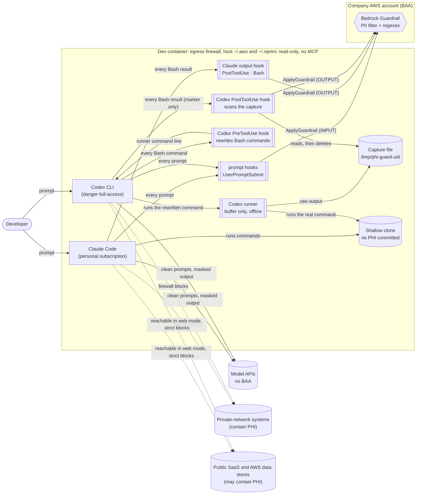
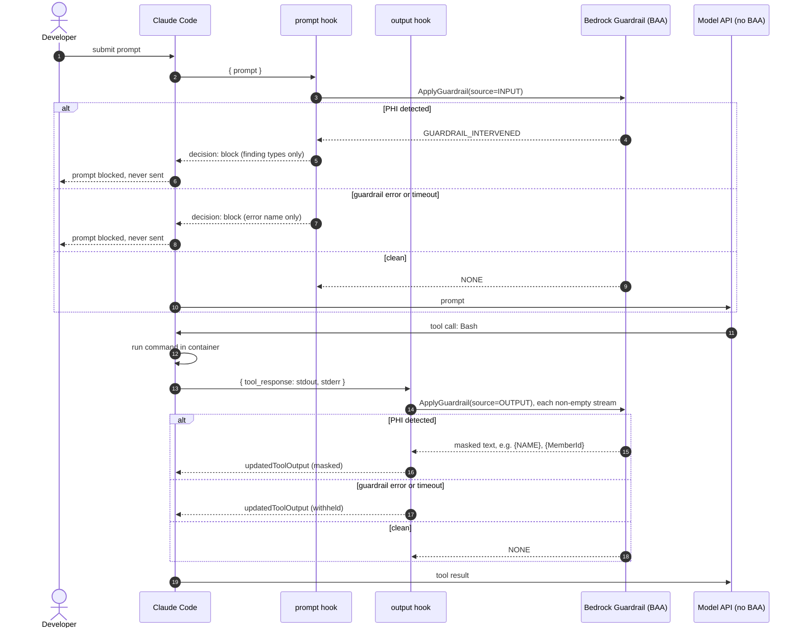
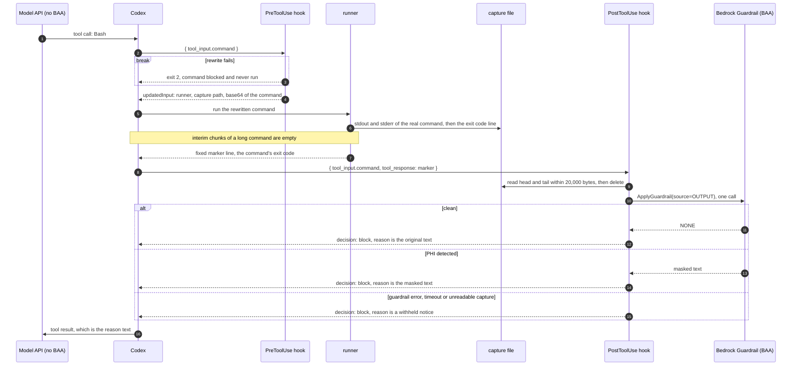

# phi-guard architecture

phi-guard lets a developer use a coding agent whose provider has no BAA, on
code-only work, without PHI reaching that provider. It supports Claude Code and
OpenAI Codex CLI. The sandbox does most of the work. The hooks catch the human
mistakes the sandbox can't, such as pasting a log line.

The hooks run as the same user as the agent, so they are a safety net against
accidents. An agent, a repo config, or any other process running as that user can
defeat them. Failure behavior below says where.

## Components and trust boundaries

Codex gets a different output path from Claude Code because of how its hooks
behave (observed on Codex CLI 0.162.1):

- A PostToolUse hook cannot rewrite a result in place. `updatedToolOutput` is
  ignored. A `decision: "block"` reply replaces the tool result with its `reason`.
- A command that runs long returns interim output chunks to the model with no
  hook. Codex does not let this be turned off.

So phi-guard never lets command output reach Codex's own output channel. The
PreToolUse hook rewrites every shell command into a call to a runner. The runner
writes the command's stdout and stderr to a capture file and prints one fixed
marker line. The PostToolUse hook reads the capture, scans it, and replaces the
marker with the masked text. The runner is offline: it imports no AWS SDK and reads
no config, because it runs inside Codex's command sandbox. Only the hooks scan.

## Request flow

Claude Code:

Codex. The prompt path matches Claude Code's. Commands go through the wrapper:

The hook scans one bounded capture per command. PostToolUse shows the model at
most 20,000 bytes (`BUDGET_BYTES`): the first and last ~9,950 bytes of the
capture, with an omitted-bytes line between them. The rest is withheld. Everything
shown was scanned. If PreToolUse failed open and the command ran unwrapped,
PostToolUse scans `tool_response` directly.

## What covers which path

| Way PHI could reach the model | Control | Claude Code | Codex |
|---|---|---|---|
| Live systems at private addresses (10/8, 172.16/12, 192.168/16, 100.64/10, 169.254/16), such as internal DBs and VPN-only tools on private IPs | Container egress firewall | Covered, for IPv4, in web and strict modes | Covered, for IPv4, in web and strict modes |
| Public SaaS (Jira cloud, Datadog) | Container egress firewall, and the container holds no credentials for them | Reachable in web mode, covered in strict mode | Reachable in web mode, covered in strict mode |
| Host secrets and config other than the mounted `~/.aws` and `~/.npmrc` (`~/.ssh`, MCP config) | Container boundary | Covered | Covered |
| PHI data stores reached with the mounted AWS credentials | In strict mode the egress firewall, then the credentials' own permissions | Reachable in web mode with the mounted credentials, so the credentials' permissions govern access. Covered in strict mode, for IPv4, unless the store's host is listed in `PHI_GUARD_EXTRA_HOSTS` | Same as Claude Code |
| Committed fixtures and history | Policy: no PHI committed; shallow clone | Covered by policy | Covered by policy |
| Text the developer types or pastes | Prompt hook (block) | Covered, limited by detection | Covered, limited by detection |
| Command output (tests, scripts) | Output hook (mask) | Covered for the `Bash` tool, limited by detection | Covered for the `Bash` tool through the wrapper, limited by detection |
| Files read with the Read tool, `@file` mentions | Not yet | **Gap** (stretch goal) | A file read through a shell command is command output and is scanned. No claim is made for other read paths |
| Pasted screenshots, images | None (no hook sees images) | **Gap**: policy only | **Gap**: policy only, including images opened with `view_image` |
| Other tools | Hook matchers | Only `Bash` output is scanned | The `^Bash$` matcher does not see other tools: for example `apply_patch`, `view_image`, other local function tools, and extension or MCP tools, which hook under `mcp__<server>__<tool>` names |
| Commands the user runs themselves with `!` | None | n/a | **Gap**: Codex runs them with no hooks, and their output enters the context |
| Shell-like MCP tools | Container config | Allowlist of none configured | Allowlist of none configured |

Neither MCP setting was exercised with a real MCP server in Part 1.

Codex's documentation calls tool hooks "a useful guardrail, not a complete
enforcement boundary", because some specialized tool paths can opt out of the hook
path. Hosted tools such as web search use no hook path.

WebSearch and Codex web search are believed to run on the provider's servers, so the
container's firewall does not carry that traffic (not verified). WebFetch and `curl`
run in the container and work in web mode.

`PHI_GUARD_FIREWALL` selects the firewall mode: `web` (the default), `strict` or
`off`. In `web` mode the container reaches any public IPv4 address and rejects the
private and internal ranges. The design treats public web traffic as PHI-free, and
treats accidental PHI access through AWS as very hard in the intended setup. `strict`
allows only the allowlist (see Devcontainer notes). `off` skips the firewall, and then
the live-systems rows are the user's responsibility. Any other value makes the script
exit before it changes a rule. The hooks never read that variable. The value is fixed
when the container is created. The firewall also writes no IPv6 rules (see the IPv4
only row in the Container table).

## Failure behavior

Claude Code:

| Failure | Prompt hook | Output hook |
|---|---|---|
| Guardrail flags PHI | Blocks the prompt | Masks the values |
| AWS error, throttling, bad credentials | Blocks (own catch) | Withholds output (own catch) |
| Scan slower than 10s | Blocks (AbortSignal) | Withholds (AbortSignal) |
| Hook crashes or exceeds 20s | Blocks (`onFailure: "block"`) | **Fails open**: `onFailure` can't withhold PostToolUse output |
| Replacement output has the wrong shape | n/a | **Fails open**: Claude Code ignores it. The hook spreads the original fields, and `scripts/e2e.sh` checks this |
| Same-uid tampering: anything that runs as the agent's uid, or a project or user settings `env`, alters the hook's inputs. Demonstrated: project `.claude/settings.json` `env.LD_PRELOAD` (needs only a committed repo file), and `PATH` and `NODE_OPTIONS` before they were pinned. Likely, not run: `env` `AWS_CONFIG_FILE` or credential variables pointing at another account's guardrail. Also user-level agent config and a killed hook process | **Can fail open** for every later prompt in the session. A substituted `node` that exits 0 with no output is not a failure | **Can fail open** for every later command in the session |

The two fail-open rows are why the output hook is bundled with no runtime
dependencies, and why its own timeout sits well under the hook timeout. The
Claude hooks use the exec form (`command: "node"` plus `args`), so no shell
reads startup files for them. That is inferred from the hook form and has not
been verified.

Codex, by hook. Codex has no `onFailure`, and every hook failure fails open at the
host level except exit 2. Every command in `hooks/codex-hooks.json` is therefore
`node <entrypoint> || { echo '<message>' >&2; exit 2; }`, and each entrypoint has
its own 15s deadline under the 20s hook timeout.

| Failure | Prompt hook | PreToolUse (wrapper) | PostToolUse (scan) |
|---|---|---|---|
| Guardrail flags PHI | Blocks the prompt | n/a | Replaces the result with the masked text |
| AWS error, throttling, bad credentials, missing config | Blocks (own catch) | n/a, it reads no config | Withholds (own catch) |
| Scan slower than 10s | Blocks (AbortSignal) | n/a | Withholds (AbortSignal) |
| Own 15s deadline | Blocks | Exit 2: the command is blocked and never runs | Withholds |
| Entrypoint exits non-zero (crash, `node` missing) | Exit 2 guard blocks | Exit 2 guard blocks the command | Exit 2 guard blocks |
| Capture file missing, unreadable, or unsafe (symlink, other owner, extra hard links, not a regular file) | n/a | n/a | Withholds, naming the cause |
| Runner cannot create the capture | n/a | n/a | The runner prints a withheld notice naming the cause and exits non-zero |
| Command arrives unwrapped (PreToolUse failed open) | n/a | n/a | Scans `tool_response` itself |
| Codex kills a hook at its 20s timeout | **Fails open**: the prompt is sent unscanned | **Fails open**: the original command runs unwrapped | **Fails open**: the final chunk reaches the model as it is |
| Hook stdout is not valid JSON, for example because the shell or its startup files printed something | **Fails open** | **Fails open** | **Fails open** |

What a PostToolUse timeout kill or JSON corruption exposes is whatever the
command's final chunk carried. For a wrapped command that is only the fixed
marker, and the output stays in the capture file. For an unwrapped command it is
the raw output. A PreToolUse failure that runs a long command unwrapped also
sends its interim chunks to the model with no hook at all.

Codex residuals. Each of these is outside what the guard and the deadline can
close.

| Residual | Effect and breadth |
|---|---|
| Codex-side timeout kill (any event) | See the table above. The 15s own deadline makes it unlikely. It cannot be closed from inside the hook |
| Shell or profile output corrupting hook JSON | Codex runs a hook command through a shell with `-c`. Observed in the container, it is the passwd shell of user `node` (bash, with `SHELL` set to zsh and to sh), which reads no startup files. Anything that shell prints before the hook runs corrupts the hook's JSON and makes the hook fail open. Applies to all three events, every turn |
| Shell startup files and `PATH` | A Codex hook command is a shell string, so a shell startup file or a `PATH` change can subvert it. Where the passwd shell is zsh, a non-login `zsh -c` reads `~/.zshenv`, and a login invocation (`zsh -lc`) also reads `~/.zprofile` and `~/.zlogin`. A file that prints, runs `exit 0`, shadows `node` or changes `PATH` turns the hook into a no-op, because the guard catches only non-zero exits. Under `danger-full-access` the agent can write those files. Applies to all three events, every later turn and session. In the container the passwd shell is bash, which reads none of them, so this path is open for a host install whose passwd shell is zsh. A `PATH` prepend in `~/.profile` still affects Codex sessions launched from a bash login terminal (demonstrated). `ZDOTDIR=/etc/zsh` would redirect a zsh passwd shell to root-owned files, but it does not protect the Codex hooks while the passwd shell is bash |
| A competing PreToolUse hook that rewrites commands | The last rewrite wins, so a command can reach Codex unwrapped. A short command is then scanned by PostToolUse. A long-running one sends interim chunks to the model with no hook. In the container, `allow_managed_hooks_only` skips plugin and user hooks (from the Codex source, not observed) |
| Same-uid tampering | Anything that runs as the agent's uid can make the hooks fail open, and so can environment it controls. Killing a hook's `node` process trips the exit-2 guard and fails closed. Killing the hook's shell fails open for that one prompt or command. `[features] hooks = false` in a user `config.toml` turns off all three hooks for every later session (the container pins `hooks = true` in `requirements.toml`). A `PATH` prepend or a startup file changes which `node` runs, as described in the previous rows. Likely, not run: `AWS_CONFIG_FILE` or credential variables pointing at another account's guardrail |
| Interrupted commands | Codex SIGKILLs the runner's process group. The command's own process runs detached in its own session, which keeps it from writing to `/dev/tty`, so it survives and keeps writing to its capture file. Its output still never reaches the model |
| Abandoned capture files | A capture that PostToolUse never reads (an interrupted command, a command whose detached child is still writing, a killed PostToolUse hook) stays in `/tmp/phi-guard-<uid>` holding raw, unscanned output until someone removes it. The directory is mode 0700 |
| Approval prompts and approval rules | They see `'<node>' '<runner>' '<capture path>' <base64>`, not the original command |
| `apply_patch` through the shell | The exec-based `apply_patch` interception is lost, because Codex no longer sees the original command |
| Very large commands | The base64 form exceeds the per-argument limit (about 128 KiB on Linux): the command fails with E2BIG and does not run. This fails closed |
| Interactive and tty commands | Output arrives only at exit |
| Interleaving and shell | The runner captures stdout and stderr into one interleaved file, and runs the command as a non-login `$SHELL -c` (Codex's login flag is lost) |
| Read-only sandbox, or `exclude_slash_tmp` | The runner cannot write its capture, so every command's output is withheld. This fails closed. phi-guard needs a Codex sandbox that allows writes to `/tmp`: workspace-write or danger-full-access |
| User `!` commands | Run with no hooks, and their output enters the context |
| MCP and other non-Bash tools | Hook under their own names (`mcp__<server>__<tool>`) and are not matched. The container configures an MCP allowlist of none |

Container:

| Residual | Effect and breadth |
|---|---|
| AWS endpoint IPs rotate (strict mode) | The strict firewall resolves DNS once, when it starts. After a rotation the Bedrock and STS calls fail, so the hooks fail closed (prompts blocked, output withheld) until the container is restarted. A stale allowlist entry can also point at an address another party now uses (inferred, not verified) |
| Strict mode needs a real region | It reads `aws_region` from the managed Claude settings and exits before changing any rule if the value is a placeholder or does not resolve. Until Part 2 sets a real region a strict container runs without a firewall. Web mode does not read the region. The hooks still fail closed: with the placeholder region the SDK rejects the region, so prompts are blocked and output is withheld, reported under the generic error name `Error` |
| The firewall script fails midway | It flushes the rules, then (in strict mode) resolves hosts, then switches the default policies to DROP. A failure in between leaves egress open until a later run succeeds |
| IPv4 only | The firewall writes no IPv6 rules. If the Docker network gives the container IPv6, all IPv6 egress is unfiltered. Docker's default bridge has no IPv6 |
| Reference firewall rules that stay | Outbound DNS (UDP 53) to any resolver, outbound SSH (TCP 22) to any host, and the host's /24 network are allowed, as in Anthropic's reference. In web mode these accepts come before the private-range rejects, so DNS and SSH also reach private addresses, and the host's /24 stays reachable although it usually sits inside a rejected range |
| VPN-gated services at public addresses (web mode) | A service that admits the VPN's source IP at a public address, or an internal name that resolves to a public address, is reachable when the host routes container traffic through its VPN. Its own authentication is then the only gate. Strict mode blocks it |
| Web mode allows any public host | A tool or agent can send data to any public site. That matters only if PHI reached the context, which is what the hooks prevent. Public SaaS is reachable, and the container holds no credentials for it |
| The agent can switch firewall modes | `node` may run `sudo /usr/local/bin/init-firewall.sh` with any argument, so the agent can re-run it as `strict` or `web`. This takes deliberate action and belongs to the same-uid class below |
| `PHI_GUARD_FIREWALL=off` | No egress boundary at all. Only the exact value `off` skips the firewall, and the value is fixed when the container is created. Any value other than `web`, `strict` and `off` makes the script exit before it changes a rule, which leaves the container without a firewall and `postStartCommand` failing |
| `/home/node` is writable by the agent | This covers agent state and any shell startup files. `~/.aws` and `~/.npmrc` are read-only mounts (see the next rows). Endpoint redirection through a profile's `endpoint_url` or `AWS_ENDPOINT_URL*` is neutralised by endpoint pinning |
| The agent can read the engineer's AWS and npm credentials | `devcontainer.json` mounts the host `~/.aws` (every profile, SSO token cache and any static keys in it) and `~/.npmrc` (registry tokens). Everything the engineer's credentials can do is available to the agent, not only `bedrock:ApplyGuardrail`. In web mode any public AWS endpoint, including PHI data stores, is reachable with those credentials, and their permissions are the only limit. In strict mode egress reaches the allowlist (GitHub, npm, the model providers, Bedrock, STS, SSO, the allowlisted CodeArtifact hosts, the VS Code hosts and every `PHI_GUARD_EXTRA_HOSTS` entry), plus the reference DNS, SSH and host-network rules. With `PHI_GUARD_FIREWALL=off` the credentials reach any AWS service, including PHI data stores. A token the agent reads, for example while debugging npm auth, lands in the model provider's transcript |
| Read-only credential mounts | Both mounts are `readonly`, so the agent cannot edit the host's `~/.aws/config` or `~/.npmrc`, for example to plant a `credential_process` that a host tool later runs. The bundled AWS SDK ignores SSO token-cache write errors (from its source, not run against a real SSO session), so a token refresh inside the container works without persisting |
| Derived firewall hosts are read at start (strict mode) | The strict firewall reads `portal.sso.<region>` and `oidc.<region>` for each `sso_region` in `~/.aws/config`, the host of each CodeArtifact `registry=` URL in `~/.npmrc`, and the hostnames in `PHI_GUARD_EXTRA_HOSTS`. Entries that are not valid are skipped with a warning, and a host that does not resolve is skipped with a warning. After changing `~/.aws/config` or `~/.npmrc`, restart the container. `PHI_GUARD_EXTRA_HOSTS` is fixed when the container is created |
| Expired AWS session | The scan fails with bad credentials, so prompts are blocked and output is withheld (fail closed) until the engineer refreshes the session on the host |
| Repo-shipped enforcement | `.devcontainer/` (managed settings, `requirements.toml`, `init-firewall.sh`, `devcontainer.json`) and `dist/` live in `/workspace`, which the agent and anyone with repo write access can edit. Edits take effect at the next container start or rebuild and can remove the hooks, the managed settings or the firewall, including by changing `PHI_GUARD_FIREWALL`, and an edited `initializeCommand` runs on the host. Review `.devcontainer/` and `dist/` changes before rebuilding. Policy that engineers must not bypass belongs in server-managed settings or MDM |
| Same-uid tampering | Anything that runs as uid `node`, and any repo or user settings `env`, can make the hooks fail open (both agents). See the same-uid rows in the Claude failure table and the Codex residuals table above |
| Reference devcontainer license | The Dockerfile, `devcontainer.json` and `init-firewall.sh` are adapted from Anthropic's reference (© Anthropic PBC, subject to Anthropic's Commercial Terms of Service). Attribution is kept in each file header and in `.devcontainer/LICENSE-anthropic-reference.md` |

In the devcontainer, managed Claude `env` pins `PATH` and `NODE_OPTIONS`. That
closes those two variables only, and the environment is not locked down: other
variables, such as `LD_PRELOAD` in a project's `.claude/settings.json` `env`, still
reach the hooks. `ZDOTDIR=/etc/zsh` keeps interactive zsh from reading node-owned
dotfiles and plays no part in running the Codex hooks. The hooks share the agent's
uid, so they stay a safety net against mistakes, and an agent, a repo config or
any process running as that uid can still make them fail open. A separate uid for
the hooks would be the real fix and is out of scope.

## Configuration and enforcement

| Setting | Claude Code (`userConfig` key) | Codex (environment variable) |
|---|---|---|
| Guardrail ID | `guardrail_id` | `PHI_GUARD_GUARDRAIL_ID` |
| Guardrail version | `guardrail_version` | `PHI_GUARD_GUARDRAIL_VERSION` |
| AWS region | `aws_region` | `PHI_GUARD_AWS_REGION` |
| AWS profile (optional) | `aws_profile` | `PHI_GUARD_AWS_PROFILE` |

One reader serves both agents. The Claude entrypoints read only
`CLAUDE_PLUGIN_OPTION_*` and the Codex entrypoints read only `PHI_GUARD_*`. A missing
required value fails with the named error `MissingGuardrailConfig`, which blocks
the prompt or withholds the output. Codex has no plugin options, so its hooks
inherit the variables from the Codex process environment.

**Claude Code.** Plugin options live under `pluginConfigs` in settings, in user or
managed scope. The devcontainer ships `/etc/claude-code/managed-settings.d/phi-guard.json`.
It registers the plugin directory `/opt/phi-guard` as a marketplace
(`extraKnownMarketplaces`), force-enables `phi-guard@phi-guard`, sets
`pluginConfigs`, sets `permissions.disableBypassPermissionsMode: "disable"`, and
sets `allowManagedMcpServersOnly` with an empty `allowedMcpServers`,
`allowManagedHooksOnly`, and the `env` pins described above.

**Codex.** Plugin hooks need the user to review and trust them (trust is recorded
against the hook's hash), and `allow_managed_hooks_only` skips them (from the Codex
source, not observed). The
devcontainer therefore ships the same hooks as managed hooks: inline `[hooks]` in
`/etc/codex/requirements.toml`, auto-trusted and not disableable by the user, with
`allow_managed_hooks_only = true`, `[features] hooks = true`, an empty
`[mcp_servers]` table, and `allowed_approval_policies` of `untrusted` and
`on-request`. `test/devcontainer.test.ts` keeps these commands in step with
`hooks/codex-hooks.json`. `/etc/codex/managed_config.toml` sets
`sandbox_mode = "danger-full-access"` and `approval_policy = "on-request"`. Codex
applies its `approval_policy` as a constraint: in the built image the only
selectable approval policy is `on-request`, so `untrusted` from
`allowed_approval_policies` cannot be chosen either. Its `sandbox_mode` stays a
default: `codex exec -s read-only` runs with `sandbox: read-only`. Every
`codex exec` prints a warning that its non-interactive default (`never`) fell back
to `on-request`.

**Endpoint pinning.** The client is created with `ignoreConfiguredEndpointUrls: true`.
`AWS_ENDPOINT_URL*` environment variables and a profile's `endpoint_url` cannot
redirect scans to a fake answer. The region goes to the SDK, which rejects an
invalid one.

**Observed in Part 1** (Docker, Claude Code 2.1.296, Codex CLI 0.162.1, no login):

- Unverified item 6. With `allowManagedHooksOnly: true`, an unauthenticated
  `claude -p hi` in the built image fired the force-enabled managed plugin's
  UserPromptSubmit hook, and the `pluginConfigs` options reached it: the block reason
  carried an `errorName` other than `MissingGuardrailConfig`.
- Codex analog. Inline managed `[hooks]` in `requirements.toml` fire under
  `allow_managed_hooks_only`. That plugin hooks are skipped there comes from the
  Codex source and was not observed.
- `disableBypassPermissionsMode: "disable"` downgrades
  `--dangerously-skip-permissions` to `auto` mode, and the flag is accepted.
- Codex `--yolo` and `-c approval_policy=...` fall back to `on-request` with a
  warning that names `/etc/codex/managed_config.toml` as the constraint. The
  sandbox stays `danger-full-access`, and `-s read-only` remains selectable.

## Devcontainer notes

- **Ownership.** The CLIs (a root-owned global npm prefix), `/opt/phi-guard`,
  `/etc/claude-code`, `/etc/codex` and `/etc/zsh` are root-owned, so the agent
  cannot rewrite them. `/home/node` (shell startup files, agent state) and
  `/workspace` are writable by the agent. The mounted `~/.aws` and `~/.npmrc` are
  read-only.
- **Login volumes.** `devcontainer.json` mounts the fixed-name volumes
  `phi-guard-claude-config` and `phi-guard-codex-config` at `/home/node/.claude` and
  `/home/node/.codex`. One sandbox login per machine is shared by every repo's
  container and stays separate from the host's `~/.claude` and `~/.codex`. To sign out
  of the sandbox, remove the containers using them and run
  `docker volume rm phi-guard-claude-config phi-guard-codex-config`. phi-guard does not
  choose the login method.
- **Sandbox markers.** These markers show that a terminal is inside the sandbox.
  `runArgs` fixes the container hostname to `phi-guard-sandbox`, and the Codex status
  line in `codex/managed_config.toml` (`[tui]`) leads with the `hostname` item. The
  Codex terminal title is `activity` and `project-name` because the title has no
  hostname item. Managed settings point Claude Code's `statusLine` at the root-owned
  `/opt/phi-guard/statusline.sh`, which prints `NO PHI`, the subscription note and
  `PHI_GUARD_FIREWALL` (`web` when unset). `/opt/phi-guard/sandbox-banner.sh` is
  appended as a source line to `/etc/zsh/zshrc` and `/etc/bash.bashrc`. In interactive
  shells it prints a three-line banner that opens with `NO PHI IN THIS SANDBOX.` and
  prefixes the prompt with `[NO PHI] `. The sandbox allows no PHI, and the hooks scan
  as a safety net. Bash
  adds the prefix through `PROMPT_COMMAND` because `~/.bashrc` sets `PS1` after the
  system file. The banner returns early unless `$-` contains `i`, so the non-interactive
  `bash -c` and `zsh -c` shells that run hook commands print nothing. Whether
  Codex honours `[tui]` from `managed_config.toml` when it renders is unverified,
  because headless runs draw no TUI. The markers are
  a visual aid for the person at the terminal, and the agent can edit `~/.bashrc`.
- **Codex sandbox.** Codex runs with `danger-full-access`. The container is the
  boundary, as it is for Claude Code, which has no OS sandbox here either. Docker's
  default seccomp profile blocks the namespaces Codex's bubblewrap sandbox needs,
  and the project chose not to loosen Docker's isolation. The image carries no
  bubblewrap. `allowed_sandbox_modes` lists `read-only` and `danger-full-access`
  (Codex rejects a list without `read-only`). Read-only stays selectable and fails
  closed, as the Codex table says.
- **Host credentials.** `initializeCommand` creates `~/.aws` and an empty `~/.npmrc`
  on the host when they are missing, because Docker refuses to start a container whose
  bind source does not exist. `devcontainer.json` then mounts both read-only. The
  `phi-guard` profile named by `aws_profile` lives in the engineer's own
  `~/.aws/config` (an SSO profile whose role allows `bedrock:ApplyGuardrail`). The
  engineer refreshes sessions on the host.
- **Web mode.** The default. After the DNS, SSH, loopback and host-network accepts, it
  rejects `10.0.0.0/8`, `172.16.0.0/12`, `192.168.0.0/16`, `100.64.0.0/10` and
  `169.254.0.0/16` (the last holds the cloud metadata service), then accepts all other
  outbound traffic. It makes no DNS lookups for an allowlist and reads no region, so
  it works before Part 2. Its self-test expects `https://api.github.com/zen` to answer
  and `http://169.254.169.254/` to fail.
- **Strict firewall allowlist.** GitHub's published ranges, `registry.npmjs.org`, the
  Anthropic hosts (`api.anthropic.com`, `claude.ai`, `claude.com`,
  `platform.claude.com`), the OpenAI hosts Codex needs (`api.openai.com`,
  `chatgpt.com`, `auth.openai.com`), `bedrock-runtime.<region>.amazonaws.com`,
  `sts.<region>.amazonaws.com`, and the VS Code hosts from the reference. Optional
  hosts are added from the mounted credential files and `PHI_GUARD_EXTRA_HOSTS` (see
  the Container table). The Sentry and Statsig telemetry hosts from the reference are
  dropped. Codex hosts seen rarely in its source (`ab.chatgpt.com`,
  `files.openai.com`) are not allowed. Part 2 checks whether Codex login needs them.
- **Firewall mode.** `devcontainer.json` passes `PHI_GUARD_FIREWALL` from the host
  environment into the container, default `web`. The exact value `off` makes
  `postStartCommand` skip the firewall script. Any other value goes to the script as
  its first argument (`PHI_GUARD_EXTRA_HOSTS` is the second), and the script accepts
  only `web` and `strict`. The value is fixed when the container is created.
- **Refreshing after IP rotation (strict mode).** Restart the container.
  `postStartCommand` re-runs the script in a fresh network namespace. Re-running it
  in place is not supported.
- **Placeholders.** `REPLACE_IN_PART_2_*` values appear in
  `.devcontainer/Dockerfile` (the `PHI_GUARD_*` variables) and
  `.devcontainer/claude-code/phi-guard.json`. `test/devcontainer.test.ts` checks that
  the two agree. Until they are replaced every scan fails and the hooks fail closed.
- **Shell.** `SHELL=/bin/zsh` and `ZDOTDIR=/etc/zsh` serve interactive terminals.
  Because zsh looks for its startup files in root-owned `/etc/zsh`, users'
  `~/.zshrc` and other dotfiles are ignored and zsh keeps no history (`HISTFILE` is
  unset). Codex runs hook commands through the passwd shell of user `node` (bash,
  observed), which neither variable affects.
- **Node.** The image and the bundles target Node 20. The AWS SDK's own warning
  says versions published after the first week of January 2027 require Node 22 or
  newer, so move the base image and the esbuild target before taking those
  versions.

## Launcher

`bin/nophi` wraps the `devcontainer` CLI around `.devcontainer/devcontainer.json`, which
stays the single source for mounts, capabilities, the firewall and env. It resolves the
payload directory through symlinks (a Homebrew install links into `libexec`), so the
`devcontainer.config_file` label on the container is the normalised absolute path that
`nophi down` filters on. `Formula/nophi.rb` installs the payload files the Dockerfile
copies plus `bin/`, so the repo doubles as its own Homebrew tap.

Residuals:

- **Data-file stop.** It matches file extensions only, on untracked and gitignored files.
  `--i-checked-no-phi` skips it. Tracked files are not checked. Renamed or extensionless
  exports pass, and so do compressed exports (`.gz`, `.zip`), files inside nested git
  repos or submodules (`git ls-files` does not list them), and PHI inside a source
  file. It guards against forgetting, and a determined bypass is out of scope.
- **Health check.** One benign prompt through the Codex prompt hook shows that the
  hook's config, credentials and Bedrock are reachable at launch time. It says nothing
  about later calls, which fail closed in the hooks.
- **Terminal markers.** The title, tint, tab colour and badge depend on the terminal
  honouring the escape sequences. Terminals that ignore them show nothing, and an
  agent or shell that sets its own title or colours can overwrite them. The in-container
  markers (status line, banner, prompt, hostname) are unaffected.
- **Fail-open: a container started by other means.** The devcontainer CLI records that
  `postStartCommand` (the firewall) ran before it runs it. After a failed firewall start
  that container would skip the firewall on the next `devcontainer up`. `nophi` removes
  the labelled containers when `up` fails, which closes this for its own launches. An
  interrupt (Ctrl-C) during `devcontainer up` can still leave a container whose
  postStart marker is written; `nophi --rebuild` or `nophi down` clears it. A
  container someone starts with the devcontainer CLI or an editor, and that failed
  there, can still be reused without a firewall.
- **Upgrades.** `brew upgrade` leaves containers of the previous version running with
  their old image and config until they are removed.

## Detection limits

- The PII filter catches names, addresses, emails, phones, SSNs and similar
  identifiers. It does not catch diagnoses or clinical free text.
- Member IDs and claim numbers are caught by **your** regexes, configured as
  CloudFormation parameters at deploy time.
- There is no date-of-birth type. A regex catches DOB-named keys with a date value.
- URL, IP_ADDRESS, AGE, USERNAME and PASSWORD are off because they're noisy in dev
  output.

## Cost (Guardrails PII filter at $0.10 per 1,000 text units; regexes free)

| Usage | Per developer per month |
|---|---|
| Prompts only | ~$0.20 |
| Prompts + Bash output | ~$5 |
| Heavy agentic use | ~$40 |

Claude Code scans each non-empty output stream of a command, so a command costs up
to two requests. Codex scans one capture per command, and the capture always ends
with an exit-code line, so every command costs at least one request, and at most
about 20 text units (the 20,000-byte bound), roughly $0.002 at the rate above.

## Not yet verified (Part 2)

Part 1 had no AWS access. Nothing below is claimed to work.

1. The regex dialect Guardrails accepts. The `DateOfBirth` pattern avoids inline
   flags and uses only portable syntax.
2. Whether `InputAction` and `OutputAction` take precedence over the legacy
   required `Action` (set to BLOCK). Prompts are safe either way, because the
   hook blocks on any intervention.
3. That the IAM resource for `bedrock:ApplyGuardrail` is the guardrail ARN from
   `GetAtt GuardrailArn`.
4. The masked tag format. `{NAME}` for PII and `{MemberId}` for regexes are
   assumed.
5. Real latency per call and throttling behavior, including Service Quotas for
   text units per second. For Codex, hook latency against the 20s hook timeout.
6. The host-credential setup against the real `good-morning` flow: the SSO login and
   token refresh inside the container (`portal.sso` and `oidc` as the only extra
   hosts needed), and CodeArtifact npm installs, including whether package downloads
   use any host beyond the repository endpoint. pip and other CodeArtifact tools need
   `PHI_GUARD_EXTRA_HOSTS`. Also whether a host tool that replaces `~/.npmrc` instead
   of editing it in place leaves the container's single-file mount on the old file
   (inferred, not verified), and whether the files are readable by uid `node` on a
   Linux host.

7. The `product-engineer` role check. On the work machine, after `good-morning`, find
   the role and run the `apply-guardrail` probe with a well-formed guardrail ID that
   does not exist. `AccessDeniedException` means the role lacks the permission, and
   `ResourceNotFoundException` means it is permitted. That assumes IAM is evaluated
   before the guardrail lookup, which is likely but unverified for this API. If the
   permission is missing, attach `ApplyGuardrailPolicy` to the permission set.

Also open: the launcher's health-check pass path (that `devcontainer exec` prints
nothing on stdout when the guardrail answers), which is verified only against stubs
because live runs exercised only the block path; a Codex PostToolUse run that masks a
fake member ID against the real guardrail, Codex managed requirements behavior inside
the running container (including the empty MCP allowlist against a real server), and the real guardrail
values in the placeholders.
