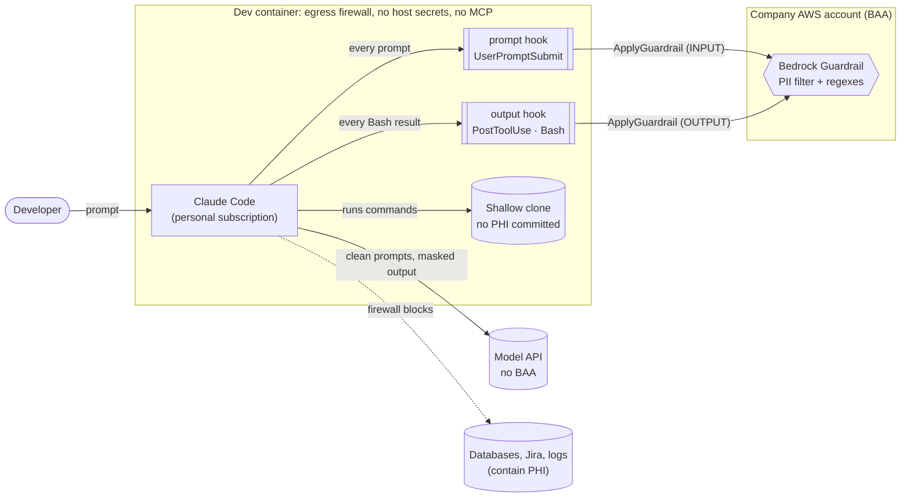
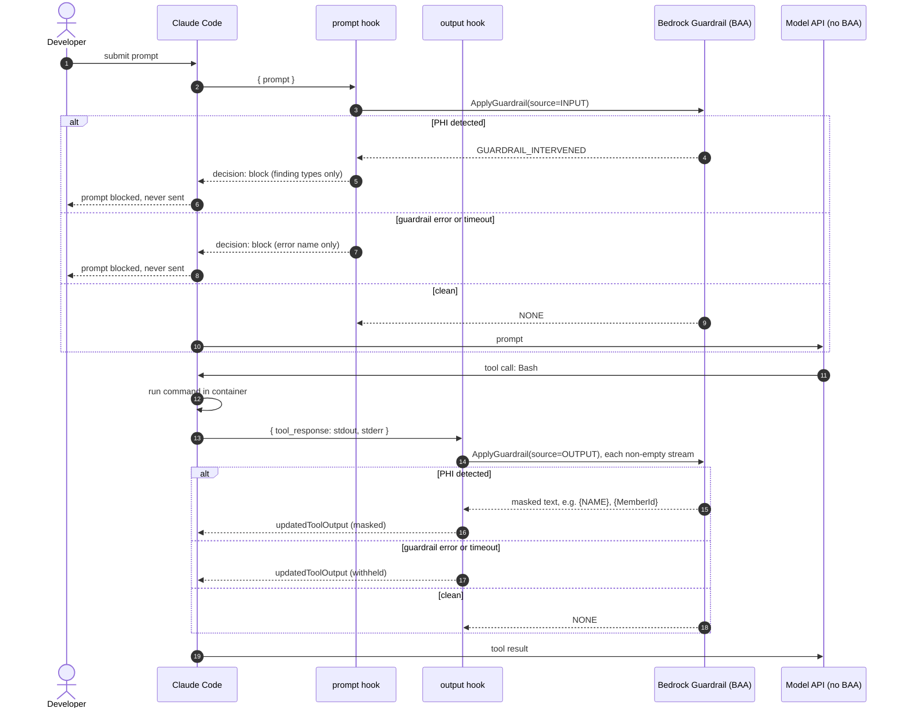

# phi-guard architecture

phi-guard lets a developer use a coding agent whose provider has no BAA, on
code-only work, without PHI reaching that provider. The sandbox does most of the
work. The hooks catch the human mistakes the sandbox can't, such as pasting a log line.

## Components and trust boundaries

## Request flow

## What covers which path

| Way PHI could reach the model | Control | Status |
|---|---|---|
| Live systems (DBs, Jira, log tools) | Container egress firewall | Covered |
| Host secrets and config (`~/.aws`, `~/.ssh`, MCP config) | Container boundary | Covered |
| Committed fixtures and history | Policy: no PHI committed; shallow clone | Covered by policy |
| Text the developer types or pastes | Prompt hook (block) | Covered, limited by detection |
| Command output (tests, scripts) | Output hook (mask) | Covered, limited by detection |
| Files read with the Read tool, `@file` mentions | Not yet | **Gap** (stretch goal) |
| Pasted screenshots | None (no hook sees images) | **Gap**: policy only |

## Failure behavior

| Failure | Prompt hook | Output hook |
|---|---|---|
| Guardrail flags PHI | Blocks the prompt | Masks the values |
| AWS error, throttling, bad credentials | Blocks (own catch) | Withholds output (own catch) |
| Scan slower than 10s | Blocks (AbortSignal) | Withholds (AbortSignal) |
| Hook crashes or exceeds 20s | Blocks (`onFailure: "block"`) | **Fails open**: `onFailure` can't withhold PostToolUse output |
| Replacement output has the wrong shape | n/a | **Fails open**: Claude Code ignores it. The hook spreads the original fields, and `scripts/e2e.sh` checks this |

The two fail-open rows are why the output hook is bundled with no runtime
dependencies, and why its own timeout sits well under the hook timeout.

## Detection limits

- The PII filter catches names, addresses, emails, phones, SSNs and similar
  identifiers. It does not catch diagnoses or clinical free text.
- Member IDs and claim numbers are caught by **your** regexes, configured as
  CloudFormation parameters at deploy time.
- There is no date-of-birth type. A regex catches DOB-named keys with a date value.
- URL, IP_ADDRESS, AGE, USERNAME and PASSWORD are off because they're noisy in dev
  output.

## Cost (Guardrails PII filter at $0.10 per 1,000 text units; regexes free)

| Usage | Per developer per month |
|---|---|
| Prompts only | ~$0.20 |
| Prompts + Bash output | ~$5 |
| Heavy agentic use | ~$40 |
